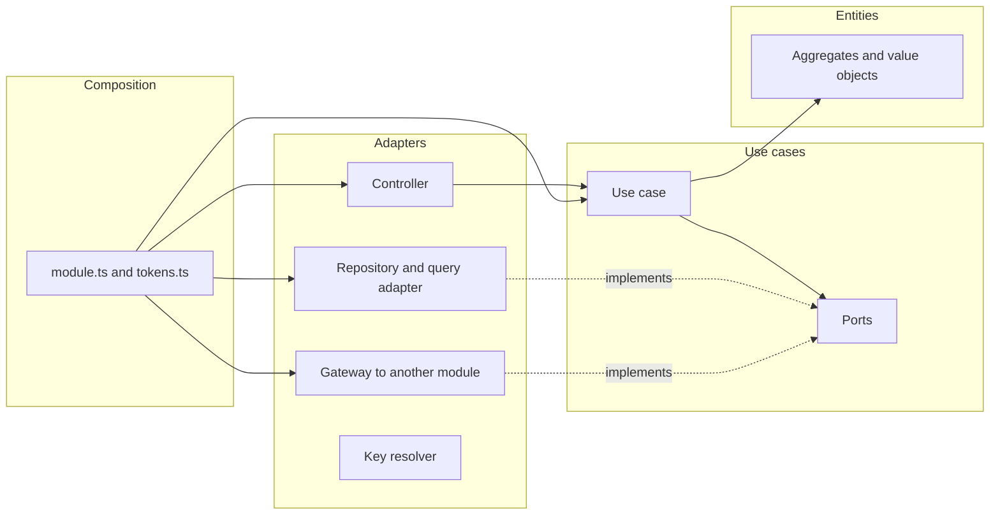
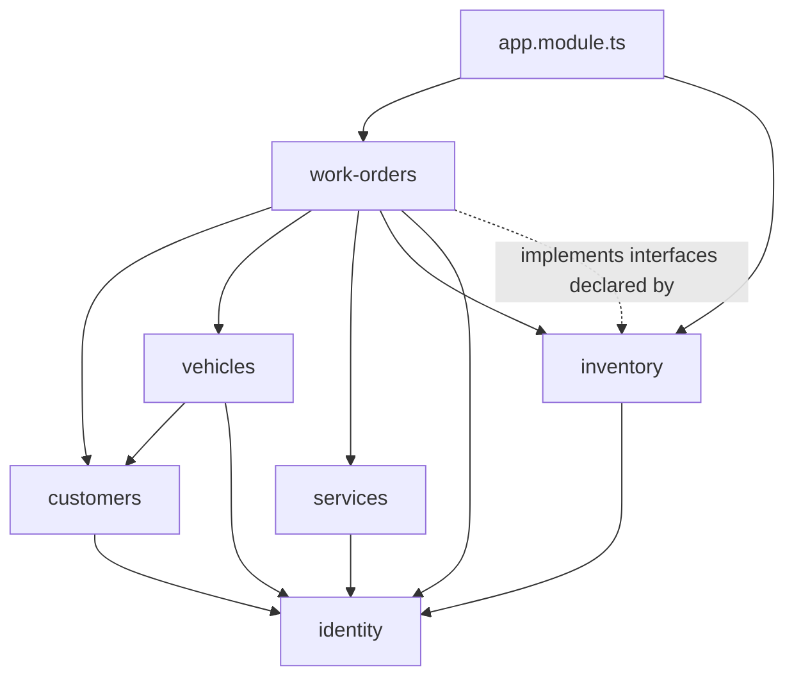
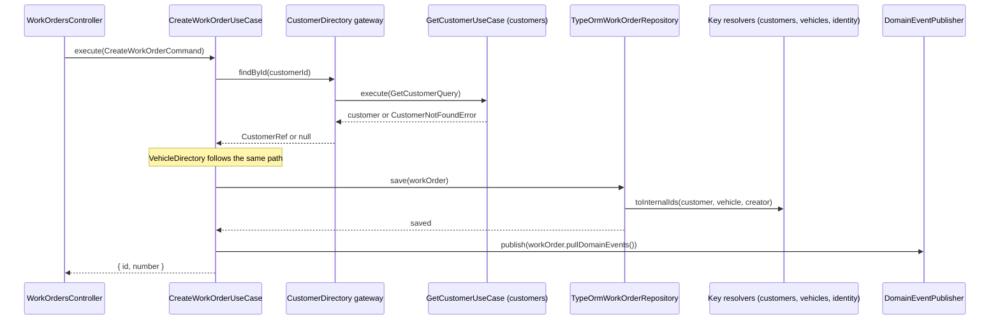

# Clean Architecture Design

**Spec**: `.specs/features/clean-architecture/spec.md`
**Context**: `.specs/features/clean-architecture/context.md`
**Status**: Approved

---

## Architecture Overview

`context.md` locks the approach (D1 to D10): use cases free of the framework and called directly by the controllers, consumer-owned ports between modules, one `identity` module, each module querying only its own tables, and checks in `npm run lint` that keep the structure from eroding. This document decides how each piece is built and in what order.

### Layers inside a module

Arrows are source dependencies. A use case imports only its own ports, its module's domain, `shared/domain` and `shared/application`. The composition root is the only place that builds use cases and knows every concrete class.



### Module dependencies after the refactor

Every arrow points one way, and `identity` depends on no other module. The dotted arrow is the one inversion: `work-orders` implements interfaces that `inventory` declares, which keeps the dependency in the same direction as the stock calls.



### A request that crosses modules: opening a work order



---

## Code Reuse Analysis

### Existing Components to Leverage

| Component | Location | How to Use |
| --- | --- | --- |
| `TransactionRunner` and `currentEntityManager()` | `src/shared/infrastructure/database/typeorm-transaction-runner.ts` | Key resolvers and cross-module writes run on the ambient manager, as repositories already do under AD-008 |
| `Clock`, `IdGenerator`, `TransactionRunner` ports | `src/shared/application/ports/` | Stay as ports; only their tokens move to `src/shared/shared.tokens.ts` |
| `SharedModule` (global) | `src/shared/shared.module.ts` | Also provides the domain event dispatcher |
| `AggregateRoot.pullDomainEvents()` | `src/shared/domain/aggregate-root.ts` | Unchanged; use cases hand its result to the `DomainEventPublisher` port |
| `BaseError`, `ErrorKind`, `GlobalExceptionFilter` | `src/shared/domain/errors/`, `src/shared/presentation/filters/global-exception.filter.ts` | Unchanged; query use cases throw the existing not-found errors |
| Query ports and their TypeORM adapters | `src/modules/*/application/ports/*-query.port.ts` | Stay the read side of each module; the adapters lose their cross-module SQL |
| `assignment.repository.ts` in `application/ports` | `src/modules/authorization/application/ports/` | Already the target placement for a repository contract |
| In-memory repositories and fakes | `test/support/fakes/` | Reused by the rewritten specs; the new port fakes follow the same style |
| Private id resolution helpers (`resolveInternalId`, `resolveExternalId`) | the TypeORM repositories of `customers`, `vehicles`, `inventory`, `work-orders` | Their SQL moves into the owners' key resolvers |
| ESLint layer rules | `eslint.config.mjs` | Extended, as described in C12 |
| `createTestApp()` | `test/support/app.ts` | Builds the application for the OpenAPI contract test |
| Swagger setup | `src/main.ts:14-21` | Moves into one function shared by `main.ts` and the contract test |

### Integration Points

| System | Integration Method |
| --- | --- |
| Nest dependency injection | Factory providers in each `<module>.module.ts`; controllers inject use case classes; one global module from `work-orders`, imported by `app.module.ts`, binds the inversion |
| PostgreSQL | Schema unchanged; each adapter queries only its own module's tables |
| Swagger | `buildOpenApiDocument(app)` serves `main.ts` and the contract test |
| Lint pipeline | `npm run lint` runs ESLint, dependency-cruiser and the table ownership check; the pre-push hook already runs `npm run lint` |

---

## Components

### C1. Use case

- **Purpose**: One application operation, framework-free, built by its composition root.
- **Location**: `src/modules/<module>/application/{commands,queries}/<name>/<name>.use-case.ts`; in identity, `src/modules/identity/<area>/application/...`
- **Interfaces**:
  - `execute(input: <Name>Command | <Name>Query): Promise<Output>`, with the input classes keeping their current names
- **Dependencies**: ports and domain only, received through the constructor
- **Reuses**: the current handler body. The class loses `@CommandHandler` or `@QueryHandler`, `@Inject`, `implements ICommandHandler` and every injected bus. Calls to another module's use case through the bus become calls to a consumer port (C3); `eventBus.publishAll(...)` becomes `events.publish(...)` (C8).

```ts
export class CreateWorkOrderUseCase {
  constructor(
    private readonly workOrders: WorkOrderRepository,
    private readonly customers: CustomerDirectory,
    private readonly vehicles: VehicleDirectory,
    private readonly idGenerator: IdGenerator,
    private readonly numberGenerator: WorkOrderNumberGenerator,
    private readonly clock: Clock,
    private readonly events: DomainEventPublisher,
  ) {}

  async execute(command: CreateWorkOrderCommand): Promise<CreatedWorkOrderDto> { /* unchanged rules */ }
}
```

### C2. Composition root and public API

- **Purpose**: Build every use case and adapter of a module, and declare what other modules may use.
- **Location**: `src/modules/<module>/<module>.module.ts`, `src/modules/<module>/<module>.tokens.ts`, `src/modules/<module>/index.ts`; shared tokens in `src/shared/shared.tokens.ts`
- **Interfaces**:
  - A factory provider per use case, keyed by the class: `{ provide: CreateWorkOrderUseCase, useFactory: (...deps) => new CreateWorkOrderUseCase(...deps), inject: [WORK_ORDER_REPOSITORY, CUSTOMER_DIRECTORY, ...] }`
  - `index.ts` exports the use cases and input/output types other modules call, the module's key resolver, and, for `identity`, the `Principal`, the decorators and the `AppPermission` and `SystemRole` enums other controllers use; for `inventory`, the `WorkOrderReads` interface and its token. It also exports the module's Nest class, because a consumer lists it in its `imports` and `through-public-api` forbids importing the module file, and the not-found error each use case throws, because the consumer's gateway catches it. The Nest module lists the use cases it exports in its own `exports`
  - `<module>.tokens.ts` holds the module's `Symbol` tokens, which leave `domain` and `application`
- **Dependencies**: Nest, every layer of the module, other modules' `index.ts`
- **Reuses**: the existing module files; `useClass` providers for adapters stay as they are

### C3. Consumer ports and gateways

- **Purpose**: Each cross-module need is a port the consumer declares and a gateway the consumer implements by calling the provider's use case.
- **Location**: ports in `<consumer>/application/ports/`, gateways in `<consumer>/infrastructure/gateways/`, fakes in `test/support/fakes/`
- **Interfaces**:

| Consumer | Port | Methods | Gateway calls |
| --- | --- | --- | --- |
| `work-orders` | `CustomerDirectory` | `findById(id): Promise<CustomerRef \| null>`, `findByUserId(userId): Promise<{ id: string } \| null>` | `GetCustomerUseCase`, `GetCustomerByUserIdUseCase` |
| `work-orders` | `VehicleDirectory` | `findById(id): Promise<VehicleRef \| null>` | `GetVehicleUseCase` |
| `work-orders` | `ServiceCatalog` | `findById(id): Promise<ServiceRef \| null>` | `GetServiceUseCase` |
| `work-orders` | `PartCatalog` | `findById(id): Promise<PartRef \| null>` | `GetInventoryItemUseCase` |
| `work-orders` | `StockLedger` | `consume(workOrderId, lines, actorUserId)`, `restore(workOrderId, lines, actorUserId)`, `settle(workOrderId, actorUserId)`, `writeOff(workOrderId, actorUserId)` | `ConsumeStockBatchUseCase`, `RestoreStockBatchUseCase`, `SettleStockMovementsUseCase`, `WriteOffStockMovementsUseCase` |
| `work-orders` | `WorkOrderActors` | `capabilitiesOf(userId): Promise<ActorCapabilities>`, `findMechanicCandidate(userId): Promise<{ isMechanic: boolean } \| null>` | `GetUserEffectiveAccessUseCase`, `GetUserByIdUseCase` |
| `customers` | `CustomerAccounts` | `findUser(userId): Promise<{ id: string } \| null>`, `hasCustomerRole(userId): Promise<boolean>`, `open(email, name, document): Promise<OpenedAccount>`, where `OpenedAccount` is `{ userId: string; temporaryPassword?: string }` because `POST /customers` shows a new account's temporary password once | `GetUserByIdUseCase`, `GetUserEffectiveAccessUseCase`, `RegisterUserUseCase` |
| `vehicles` | `VehicleOwners` | `findById(customerId): Promise<{ id: string; active: boolean } \| null>`, `findByUserId(userId): Promise<{ id: string } \| null>` | `GetCustomerUseCase`, `GetCustomerByUserIdUseCase` |

- **Dependencies**: the provider's `index.ts`. A gateway is an `@Injectable()` class wired with `useClass` under a token from the consumer's `<module>.tokens.ts`, and its constructor takes the provider's use case classes (the provider's Nest module exports them). Its spec stands in for each provider use case with an object that has `execute` alone, cast to the class because the class keeps private fields, and the stand-in answers only for the key it expects, so a gateway that sends the wrong identifier gets `null`
- **Reuses**: the provider use cases as they exist; the `WorkOrderActors` gateway maps `AppPermission.WorkOrdersDecide`, `WorkOrdersCancelInExecution` and `WorkOrdersManage` to the three capabilities, and the `MECHANIC` role to `isMechanic`, so `work-orders` stops importing the permission catalog

### C4. Key resolvers

- **Purpose**: Translate between an owner's UUIDs and its internal keys for other modules, so no module reads another module's table.
- **Location**: `src/modules/<owner>/infrastructure/persistence/<entity>-key-resolver.ts` for `identity` (users), `customers`, `vehicles`, `services` and `inventory` (inventory items); exported through `index.ts`
- **Interfaces** (each owner its own class, same shape):
  - `toInternalId(externalId: string): Promise<string | null>`
  - `toExternalId(internalId: string): Promise<string | null>`
  - `toInternalIds(externalIds: string[]): Promise<Map<string, string>>`
  - `toExternalIds(internalIds: string[]): Promise<Map<string, string>>`
- **Dependencies**: `DataSource`; `currentEntityManager()` first, so a row written earlier in the caller's transaction resolves (CA-03 AC13). A repository that opens its own transaction publishes its manager as the ambient one, so the resolvers it calls join that transaction and never hold a second connection
- **Reuses**: the SQL of today's private helpers; a missing row yields `null`, and the calling repository keeps throwing the plain `Error` it throws today

### C5. Owner read API for the customer listing

- **Purpose**: Give `customers` the user data its listing shows, without a join on `users`.
- **Location**: `src/modules/identity/users/application/queries/find-users/find-users.use-case.ts`
- **Interfaces**:
  - `execute(query: FindUsersQuery): Promise<UserSummaryDto[]>`, with `FindUsersQuery { ids?: string[]; nameContains?: string; document?: string }`
- **Dependencies**: `UserQueryPort`, extended with the same three filters
- **Reuses**: `PersonDocument` parsing as `ListUsersHandler` does it: a malformed document returns `[]`. The name filter stays `ILIKE '%' || $n || '%'` in identity's own SQL, and users of any status are returned, because the customer listing joins `users` without a status filter today

### C6. The `inventory` and `work-orders` inversion

- **Purpose**: Let `inventory` read work order data without depending on `work-orders`.
- **Location**: interface and token in `src/modules/inventory/infrastructure/work-order-reads.ts` (exported by inventory's `index.ts`); implementation `TypeOrmWorkOrderReads` in `src/modules/work-orders/infrastructure/persistence/`; binding module `src/modules/work-orders/work-order-reads.module.ts`
- **Interfaces** (`WorkOrderReads`):
  - `internalIdOf(workOrderId: string): Promise<string | null>`
  - `externalIdsOf(internalIds: string[]): Promise<Map<string, string>>`
  - `outstandingDemand(): Promise<OutstandingDemandRow[]>`, where each row is `{ inventoryItemInternalId, outstanding, workOrderNumbers }` for planned minus withdrawn quantities on approved budgets of work orders in execution
  - `openWorkOrderNumbersUsing(inventoryItemInternalId: string): Promise<string[]>`, for work orders neither delivered nor canceled, ordered by number
- **Dependencies**: `TypeOrmWorkOrderReads` reads only `work_orders`, `work_order_parts` and `work_order_budgets`. `WorkOrderReadsModule` is `@Global()`, provides and exports `WORK_ORDER_READS`, and `app.module.ts` imports it once; `InventoryModule` injects the token without importing anything from `work-orders`
- **Reuses**: the SQL of today's `SELECT_SHORTAGES` and `SELECT_OPEN_WORK_ORDERS_USING_ITEM`, split at the module boundary. The rows carry inventory's internal key because `work_order_parts.inventory_item_id` is a column of a `work-orders` table and both sides are infrastructure; no use case or port sees an internal key

### C7. Adapters rewritten to query only their own tables

| Adapter | Today | After |
| --- | --- | --- |
| `TypeOrmCustomerRepository` | Lookups on `users`; a join on `users` in `existsByUserId` | `UserKeyResolver`; own table only |
| `TypeOrmCustomerQueryAdapter` | Join on `users` for name, email and document, and filters on `users` columns | With a filter: `FindUsersUseCase` first, then `UserKeyResolver.toInternalIds`, then `customers` filtered by those user keys. Without a filter: `customers` first, then `toExternalIds` and `FindUsersUseCase({ ids })`. Ordering stays `customers.created_at DESC` |
| `TypeOrmVehicleRepository` | Lookups on `customers` | `CustomerKeyResolver` |
| `TypeOrmVehicleQueryAdapter` | Join on `customers` for the owner UUID | `CustomerKeyResolver.toExternalIds`; `listByCustomerId` resolves the owner first |
| `TypeOrmInventoryItemRepository` | Lookups on `users` and `work_orders`; joins on `work_orders` in the settle, write-off and pending queries | `UserKeyResolver` and `WorkOrderReads.internalIdOf`; filters `stock_movements.work_order_id` directly |
| `TypeOrmInventoryQueryAdapter` | Shortage report and in-use check on `work-orders` tables; history joins `users` and `work_orders` | `WorkOrderReads.outstandingDemand` and `openWorkOrderNumbersUsing` combined with its own `inventory_items`; history through `UserKeyResolver` and `WorkOrderReads.externalIdsOf` |
| `TypeOrmWorkOrderRepository` | Lookups on `customers`, `vehicles`, `users`, `services` and `inventory_items`, with table names built at runtime | The five owners' key resolvers; the runtime-table helpers are deleted |
| `TypeOrmWorkOrderQueryAdapter` | Joins for eight kinds of UUIDs | Own tables, then the resolvers in batch, one call per owner per request |
| `TypeOrmWorkOrderMetricsQueryAdapter` | `EXISTS` with a join on `services` | `ServiceKeyResolver.toInternalId` before the query |

### C8. Domain event publisher

- **Purpose**: Publish domain events without a framework in the use case, keeping today's semantics.
- **Location**: port `src/shared/application/ports/domain-event-publisher.port.ts`; dispatcher `src/shared/infrastructure/events/in-memory-domain-event-dispatcher.ts`
- **Interfaces**:
  - `DomainEventPublisher.publish(events: DomainEvent[]): void`
  - `DomainEventSubscriber<E>.handle(event: E): void | Promise<void>`
  - `InMemoryDomainEventDispatcher.subscribe(eventType, subscriber): void`
- **Dependencies**: Nest `Logger` in the dispatcher only
- **Reuses**: the behavior of `@nestjs/cqrs` 11.0.3: each subscriber starts at once and is not awaited, and a synchronous throw or a rejected promise is caught and logged at error level as `"<SubscriberName>" has thrown an unhandled exception.` under the `EventBus` context. The bus fills that name from Nest's provider wrapper and prints `InstanceWrapper`; the dispatcher prints the subscriber's class name. `SharedModule` provides `InMemoryDomainEventDispatcher` and binds `DOMAIN_EVENT_PUBLISHER` to the same instance with `useExisting`, exporting both: use cases receive the port through the token, and the identity composition root injects the class and subscribes `AccessCacheInvalidationSubscriber` and the refresh-token-reuse log subscriber on module init. No bridge to the Nest bus is needed during the migration, because both subscribers live in `identity` and move together with the use cases that publish their events

### C9. Identity module

- **Purpose**: One module for the three areas that depend on one another.
- **Location**: `src/modules/identity/{users,authentication,authorization}/{domain,application,infrastructure,presentation}`, with `identity.module.ts`, `identity.tokens.ts` and `index.ts` at the module root
- **Interfaces**: the union of the three modules' controllers and the public API listed in C2
- **Dependencies**: inside the module, a use case may call another area's use case: deactivation and password change end sessions, registration assigns the `CUSTOMER` role, login and refresh read the user, role assignment checks the user, session revocation reads permissions
- **Reuses**: every file of the three modules, moved with paths only; the move runs before any flow migrates, with the bus still in place

### C10. Not-found decided in the query use case

- **Purpose**: Keep the not-found rule in the core, so any entry point inherits it.
- **Location**: the query use cases behind a read by identifier: get work order, get own work order, get service, get inventory item, get vehicle, get customer, get customer by user, get user by id, get role
- **Interfaces**: each throws its module's existing error (`WORK_ORDER_NOT_FOUND`, `SERVICE_NOT_FOUND`, `INVENTORY_ITEM_NOT_FOUND`, `VEHICLE_NOT_FOUND`, `CUSTOMER_NOT_FOUND`, `USER_NOT_FOUND`, `ROLE_NOT_FOUND`) and the controllers' `get*OrThrow` helpers disappear
- **Dependencies**: none new
- **Reuses**: the gateways in C3 catch the provider's not-found class and return `null`, so each consumer keeps raising its own error, such as `ReferencedCustomerNotFoundError`. Get customer keeps returning deactivated customers, which is what separates 404 from 422 for vehicle registration (`src/modules/customers/infrastructure/persistence/typeorm-customer-query.adapter.ts:44-50`)

### C11. Authentication settings and the reuse log

- **Purpose**: Remove `@nestjs/config` and the Nest `Logger` from identity's application layer.
- **Location**: `src/modules/identity/authentication/application/auth-settings.ts`; the subscriber moves to `src/modules/identity/authentication/infrastructure/logging/`
- **Interfaces**: `AuthSettings { accessTokenTtlSeconds: number; refreshTokenTtlSeconds: number; sessionAbsoluteTtlSeconds: number }`, built in `identity.module.ts` from `authConfig`
- **Dependencies**: none in the core
- **Reuses**: the subscriber keeps its `AuthenticationSecurity` context and its message

### C12. Architecture checks

- **Purpose**: Make `npm run lint` fail on every structural rule of the spec.
- **Location**: `eslint.config.mjs`, `.dependency-cruiser.cjs`, `.dependency-cruiser-known-violations.json`, `scripts/architecture/check-table-ownership.ts`, `scripts/architecture/table-owners.ts`, `scripts/architecture/known-table-findings.json`, `scripts/architecture/check-module-cycles.ts`
- **Interfaces**:
  - ESLint: the `domain` and `application` blocks stop ignoring specs; the application ban list gains `@nestjs/*`, `class-validator`, `class-transformer`, `zod`, `rxjs`, `rxjs/*` and `node:*`; both blocks gain `no-restricted-syntax` for `Decorator` and for `CallExpression[callee.name='Symbol']`. During the migration the blocks list the migrated modules; at the end they cover `src/**`
  - dependency-cruiser 18.7, cruising `src` with type-only imports counted: `no-circular`; `core-stays-in-module` (from `^src/modules/([^/]+)/(?:[^/]+/)?(domain|application)/` to `^src/modules/`, `pathNot` `^src/modules/$1/`); `through-public-api` (from `^src/modules/([^/]+)/` to `^src/modules/[^/]+/`, `pathNot` `^src/modules/$1/` and `^src/modules/[^/]+/index\.ts$`); `inward-only` (no import from `domain` or `application` into `infrastructure` or `presentation`, and none from `domain` into `application`); `shared-is-a-leaf` (no import from `src/shared` into `src/modules`). The baseline is written with `--baseline` and read with `--ignore-known`; a migrated flow removes its entries with `--baseline --baseline-mode shrink-only`, which cannot add one
  - Table ownership check: an explicit map of the 19 tables to their modules; it scans `src/modules/**/infrastructure/**/*.ts` for the table after `FROM`, `JOIN`, `INTO` and `UPDATE`, fails on a table another module owns, on an unknown table and on a table name built at runtime (`${` after those keywords), and fails when a migration creates a table the map lacks. Its known-findings file shrinks to empty like the dependency baseline
  - Module cycle check: collapses the cruised graph to modules (each folder under `src/modules`, and `src/shared`) and fails on any cycle between them, naming for each step a file that imports and the file it imports. `no-circular` alone sees only the cycles that close file by file. It has no known list, because the module graph has no cycle once `identity` exists
  - `npm run lint` becomes `eslint . && npm run lint:architecture`, with `lint:architecture` running `depcruise src --ignore-known`, the table check and the module cycle check
- **Dependencies**: `dependency-cruiser` as a dev dependency; `ts-node`, already a dev dependency
- **Reuses**: the existing ESLint blocks and the pre-push hook

### C13. OpenAPI contract check

- **Purpose**: Prove that every route keeps its paths, payloads and status codes (CA-02 AC1).
- **Location**: `src/openapi.ts`; baseline `test/contract/openapi.baseline.json`; test `test/e2e/openapi-contract.e2e.spec.ts`
- **Interfaces**: `buildOpenApiDocument(app: INestApplication): OpenAPIObject`, holding today's `DocumentBuilder` setup; `main.ts` calls it
- **Dependencies**: `createTestApp()`
- **Reuses**: the baseline is generated once, on the commit before the first code change, and never regenerated by this feature. The test compares after sorting object keys recursively and keeping array order, because moving modules reorders `paths` and `components.schemas` without changing them

### C14. Seed CLI

- **Purpose**: Prove that a second entry point reuses the use cases (CA-06).
- **Location**: `scripts/seed.ts`
- **Interfaces**: `context.get(CreateServiceUseCase)` and the same for create inventory item, replenish stock, register customer and register vehicle, each followed by `execute`
- **Dependencies**: the Nest application context, as today
- **Reuses**: staff accounts stay direct inserts (AD-006), and the existence checks that make the seed idempotent stay

### C15. Test support

- **Purpose**: Specs that exercise real entities against fakes at the ports (CA-05).
- **Location**: `test/support/fakes/`, `test/integration/`, `vitest.config.ts`
- **Interfaces**: one fake per consumer port in C3, plus `RecordingDomainEventPublisher`; each fake holds seeded data and records what it received, so specs assert state
- **Dependencies**: none
- **Reuses**: the existing in-memory repositories. The in-memory `WorkOrderRepository` refuses what the table's unique indexes refuse, a number held by another work order and a second work order not yet delivered or canceled on a vehicle, so a use case spec reaches its retry loop by seeding the repository and reads the attempts from the draws the number generator fake recorded. The 11 integration specs of the rewritten adapters build them with the real key resolvers and owner use cases against the test database. The coverage globs at `vitest.config.ts:36`, `:59` and `:98` follow the identity move with the same percentages. `test/support/fakes/bus.stubs.ts` is deleted when the last module migrates

---

## Data Models

No schema change. The new contracts are TypeScript types:

```ts
// src/modules/work-orders/application/ports
interface CustomerRef { id: string; name: string; active: boolean }
interface VehicleRef { id: string; customerId: string; plate: string; brand: string; model: string; year: number }
interface ServiceRef { id: string; name: string; priceCents: number; active: boolean }
interface PartRef { id: string; sku: string; name: string; unitPriceCents: number; active: boolean }
interface StockLine { inventoryItemId: string; quantity: number }
interface ActorCapabilities { decidesAnyBudget: boolean; cancelsInExecution: boolean; managesWorkOrders: boolean }

// src/modules/inventory/infrastructure/work-order-reads.ts
interface OutstandingDemandRow { inventoryItemInternalId: string; outstanding: number; workOrderNumbers: string[] }

// src/modules/identity/authentication/application/auth-settings.ts
interface AuthSettings { accessTokenTtlSeconds: number; refreshTokenTtlSeconds: number; sessionAbsoluteTtlSeconds: number }
```

**Relationships**: each `Ref` carries exactly the fields its use case reads today (`customer.name` and `status`, the vehicle's owner and description, the service's name, price and status, the item's SKU, name, price and status); `active` replaces the comparison with the `'ACTIVE'` string.

---

## Migration Sequence

Each phase leaves lint, build and the three suites green. Tasks refine the phases; this order is the design's.

| Phase | Content | Exit |
| --- | --- | --- |
| 0. Safety net and records | OpenAPI baseline and contract test; characterization e2e for the 9 routes without one; e2e assertions for the not-found edge cases asserted only in unit tests; ADRs 0026 to 0031 | Contract test green on the untouched code |
| 1. Checks in report mode | dependency-cruiser with its baseline; the table check with its known findings; ESLint ratchet structure | `npm run lint` green with the baselines |
| 2. Identity move | `users`, `authentication` and `authorization` under `src/modules/identity`, one Nest module, coverage globs | All suites green, OpenAPI document unchanged |
| 3. Shared pieces | `DomainEventPublisher` port, dispatcher, recording fake; shared tokens relocated | Dispatcher specs green |
| 4. Key resolvers and owner API | The five key resolvers with integration specs; `FindUsersUseCase` | Resolver specs green, including the in-transaction case |
| 5. Pilot | Opening a work order end to end: use case, `CustomerDirectory`, `VehicleDirectory`, gateways, composition, controller route, fakes, spec | Pattern confirmed; adjustments recorded before scaling |
| 6. Inversion proof | `WorkOrderReads`, `TypeOrmWorkOrderReads`, `WorkOrderReadsModule`; the shortage report and the in-use check switched | App boots in e2e; shortage and in-use e2e green |
| 7. Modules | `services`, `inventory`, `identity`, `customers`, `vehicles`, then the rest of `work-orders`: use cases, tokens, repository contracts, not-found, gateways, adapters on own tables, specs on fakes, ESLint ratchet, baseline entries removed; the rename to `UseCase` in its own commit per module | Each module's baseline entries gone |
| 8. Bus removal and enforcement | `CqrsModule`, `@nestjs/cqrs` and the bus stubs removed; seed on use cases; empty baselines; acceptance checks | All Success Criteria of the spec |
| 9. Documentation | README circles and module graph; low-level designs, C4 diagrams and the architecture overview updated | CA-09 greps clean |

---

## Error Handling Strategy

| Error Scenario | Handling | User Impact |
| --- | --- | --- |
| A query use case finds no record | Throws its module's not-found error | 404 with the same code as today |
| A consumer asks a provider for a missing record | The gateway catches the provider's not-found error and returns `null`; the consumer raises its own error | The consumer's code, as today (for example `REFERENCED_CUSTOMER_NOT_FOUND` on `POST /work-orders`) |
| A key resolver finds no row | Returns `null`; the repository throws a plain `Error`, as the private helpers do today | 500, as today; it signals data inconsistency |
| A domain event subscriber fails | The dispatcher logs it at error level with the subscriber's name | None: the caller already has its result |
| The second write of a cross-module operation fails | The shared transaction rolls back (AD-008), now through direct calls inside `transactionRunner.run` | The provider's error code; nothing persisted |
| `WORK_ORDER_READS` has no binding | Nest fails at bootstrap | None in production; the e2e suite fails first |
| A forbidden import or table access appears | `npm run lint` exits non-zero naming the file and the rule | None; caught before push |

---

## Risks & Concerns

| Concern | Location (file:line) | Impact | Mitigation |
| --- | --- | --- | --- |
| The inversion binding is a new pattern in this codebase | `src/app.module.ts` (module imports) | The app fails at boot if Nest cannot resolve `WORK_ORDER_READS` | `@Global()` module imported once at the root, the mechanism Nest documents for this; phase 6 proves it by booting the app in e2e before the pattern spreads; fallback in Tech Decisions |
| Reads composed in memory add queries | `src/modules/work-orders/infrastructure/persistence/typeorm-work-order-query.adapter.ts:82-126` | The work order detail runs five more batch queries | Batch resolver methods, one call per owner per request; accepted in the spec |
| Get customer must keep returning deactivated customers | `src/modules/customers/infrastructure/persistence/typeorm-customer-query.adapter.ts:44-50` | A gateway that filters them would turn a 422 into a 404 | `VehicleOwners` and `CustomerDirectory` expose `active`; the existing e2e on deactivated customers stays green |
| Key order of the OpenAPI document changes when modules move | `src/main.ts:14-21` | A byte comparison fails with no behavior change | Canonical comparison with sorted keys (C13) |
| Nine routes have no e2e test | `src/modules/authorization/presentation/controllers/roles.controller.ts`, `permissions.controller.ts`, `user-access.controller.ts` | Their flows would migrate with no record of current behavior | Characterization e2e in phase 0 (CA-02 AC3) |
| Not-found codes for work orders, services, vehicles and roles are asserted only in unit tests | `src/modules/work-orders/presentation/controllers/work-orders.controller.ts:533-538` | Moving the 404 into the use case could change a route's answer unnoticed | One e2e assertion per not-found edge case before the move (L-003) |
| Table names built at runtime hide cross-module reads | `src/modules/work-orders/infrastructure/persistence/typeorm-work-order.repository.ts:389`, `:404`, `:420`; `src/modules/inventory/infrastructure/persistence/typeorm-inventory-item.repository.ts:263` | A text search misses them, as the first search in Specify did | Helpers deleted; the table check rejects a runtime table name |
| Coverage globs point at the old identity paths | `vitest.config.ts:36`, `:59`, `:98` | Thresholds stop applying after the move with no failure | Updated in the move task with the same percentages (CA-05 AC4) |
| Event semantics could drift from fire-and-forget | `node_modules/@nestjs/cqrs/dist/event-bus.js:123-129` | Awaiting subscribers would delay responses and surface their errors | Dispatcher specs for an immediate start, a synchronous throw and a rejected promise |
| The seed depends on the bus | `scripts/seed.ts:175` | The seed breaks when the bus leaves | Switched in phase 8; `npm run seed` in the acceptance checks |
| New integration fixtures could collide in the never-truncated test database | `.specs/STATE.md` Conventions | Flaky gates | UUID-derived unique values in every new fixture |
| The customer listing has no pagination | `src/modules/customers/infrastructure/persistence/typeorm-customer-query.adapter.ts:65-74` | Composition in memory loads every matching customer, as the join does today | Unchanged by this feature; noted for the Phase 2 listing work |

---

## Tech Decisions

| Decision | Choice | Rationale |
| --- | --- | --- |
| Binding for the `inventory` interfaces | `@Global()` `WorkOrderReadsModule`, imported by `app.module.ts` | `forwardRef` would make `inventory.module.ts` import `work-orders.module.ts`, a source cycle; a dynamic `InventoryModule.register()` would need the same instance handed to `WorkOrdersModule`. Fallback if phase 6 fails: dynamic registration at the root |
| Key resolver code | One class per owner, no shared base | `src/shared` must not grow (CA-03 AC7) and each module stays independent; about 40 duplicated lines accepted |
| Where cross-module reads are composed | In the consumer's read adapter | Reads carry no rules; query use cases stay thin; matches CA-03 AC11 |
| Keys in `WorkOrderReads` | Inventory's internal keys, in infrastructure only | `work-orders` reads its own column; no use case or port sees an internal key |
| Statuses returned by `FindUsersUseCase` | Users of any status | The customer listing joins `users` without a status filter today |
| Not-found across modules | Providers throw; gateways map to `null` | One not-found rule in the core; consumers keep their own errors |
| Calls between identity areas | Direct use case calls | Same module; a port inside one module adds nothing |
| Dispatcher log line | Same message and `EventBus` context as `@nestjs/cqrs` | Log continuity for whoever reads them |
| OpenAPI comparison | Canonical JSON | Key order carries no meaning |
| Table ownership source | Explicit map, cross-checked against migrations | `stock_movement_transitions` has no ORM entity, so entities alone miss it |
| ESLint rollout | Bans listed per migrated module, then `src/**` | Each module turns them on when it migrates |
| Rename to `UseCase` | Right after each module migrates, in its own commit | Mechanical diffs stay apart from behavior changes |

**Project-level decisions** appended to `.specs/STATE.md` as AD-011 to AD-016, superseding AD-003. Their ADRs, 0026 to 0031, are written in phase 0, and ADR 0008 gets the status `Superseded by 0027`.

---

## Requirement Mapping

| Requirement | Components |
| --- | --- |
| CA-01 | C1, C2, C11, C12 |
| CA-02 | C10, C13, phase 0 |
| CA-03 | C3, C4, C5, C6, C7, C8, C9 |
| CA-04 | C12 |
| CA-05 | C15 |
| CA-06 | C14 |
| CA-07 | ADRs 0026 to 0031, AD-011 to AD-016 |
| CA-08 | Phase 7 renames |
| CA-09 | Phase 9 |
