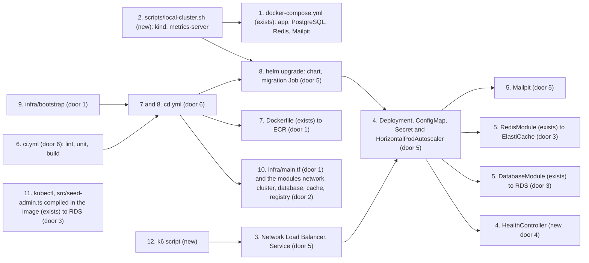

# Phase 2 infrastructure

**Approved**: 2026-11-02 - user: "Sim"

## Problem

The application runs only through `docker-compose` on one machine: one container per piece, a local PostgreSQL and Redis, one replica. Nothing provisions a cluster or a managed database, no manifest describes how the application runs in Kubernetes, and no pipeline builds, tests or deploys it, so every check runs by hand and a release is whatever someone builds locally. The application has no health endpoint a cluster could probe, it cannot reach a database that requires SSL or a Redis that requires TLS, and its migrations and seeds run only through development tooling that the production image does not carry. The Phase 2 brief requires the containerized application, Kubernetes manifests with a Horizontal Pod Autoscaler, Terraform for the cluster and the database, a CI/CD pipeline that builds, tests, builds the image and deploys, and a README that documents all of it.

Evidence: the Phase 2 brief, pages 3 to 5, "Infraestrutura" and "Entregáveis da fase 2". The brief gives no load figures.

When this ships, development runs on the developer's machine: `docker compose` runs PostgreSQL, Redis and Mailpit in local containers, and a local kind cluster runs the same chart against them. Every push runs lint, the unit tests and the build in parallel, and every merge to `main` that passes them provisions or updates `prod`, the only environment in AWS, with Terraform, pushes the image, runs the migrations and applies the chart. The application runs in Kubernetes behind a load balancer and adds or removes pods with CPU and memory. The user reaches the `prod` database through the cluster with the database user Terraform configures, and creates the SUPER_ADMIN there. The README explains how to run it locally, provision it, deploy it and reach its database, with the architecture drawn.

## Shape

This reuses the existing Dockerfile and `docker-compose.yml`, the application's database and Redis modules, the TypeORM migrations, the admin seed script and the unit suite as they are; the infrastructure adds Terraform, a Helm chart, a local cluster script and two workflows around the application without moving any rule into it. The rules that change an outcome run in the application's configuration and health layers, reached by the unit and e2e suites; in the chart's and Terraform's own tests, which render or plan the configuration with no cloud access; and in the local cluster, which installs the chart.

Development, on the developer's machine:

1. `docker compose up` -> `docker-compose.yml` (exists) - the application, PostgreSQL, Redis and Mailpit in local containers, configured by `.env`; nothing runs in AWS
2. `scripts/local-cluster.sh` (new) - creates a kind cluster with metrics-server, builds and loads the image, and installs the chart (door 5) with the local values, whose pods reach the PostgreSQL, Redis and Mailpit of step 1

Runtime, in the `prod` cluster:

3. a request -> AWS Network Load Balancer -> `Service` of type LoadBalancer (door 5) -> a pod of the `Deployment` (door 5)
4. `Deployment` (door 5) - runs the image, probes `HealthController` (new, door 4), takes its settings from a ConfigMap and a Secret (door 5), and grows or shrinks through the `HorizontalPodAutoscaler` (door 5), which reads CPU and memory from metrics-server (door 1)
5. the pod -> `DatabaseModule` (exists) over TLS to RDS (door 3), and `RedisModule` (exists) over TLS to ElastiCache (door 3); e-mails go to a Mailpit `Deployment` (door 5)

Delivery, on GitHub Actions:

6. a push -> `ci.yml` (door 6) - lint, unit tests and build as three parallel jobs
7. the CI succeeds on a merge to `main` -> `cd.yml` (door 6) - assumes the deploy role through GitHub OIDC (door 1), applies `infra/main.tf` (door 1) with the `prod` files, reads the secrets from Secrets Manager (door 3), builds the image of that commit from the `Dockerfile` (exists) and pushes it to ECR (door 1)
8. `cd.yml` (door 6) -> `helm upgrade --install` of the chart (door 5) with the prod values - the migration Job runs before the pods change

Provisioning, with Terraform:

9. `infra/bootstrap` (door 1) - applied once from the user's machine: the state bucket, the GitHub OIDC provider and the deploy role
10. `infra/main.tf` (door 1) - the one entry that wires the modules network, cluster, database, cache and registry (door 2), configured only by `infra/environments/prod.tfvars` and `prod.backend.hcl`

Operation, from the user's machine:

11. the user's `kubectl` (door 1) -> a pod in the `prod` cluster -> RDS with the database user from Secrets Manager (door 3) - a session to create the SUPER_ADMIN by hand, or the admin seed (`src/seed-admin.ts`, which `scripts/seed-admin.ts` runs for development), compiled in the image as `dist/seed-admin.js`

Load demonstration:

12. a k6 script (new) - signs in once and lists the board with a growing number of virtual users against a base URL, the local cluster's or `prod`'s, while `kubectl get hpa -w` shows the replicas change

**Changes underneath**

| Front | What changes |
| --- | --- |
| domain | nothing: no domain term changes meaning |
| stored data | nothing to migrate; the same migrations run in a Job against RDS, and against the compose PostgreSQL in the local cluster |
| configuration | new settings `DATABASE_SSL`, `DATABASE_SSL_CA` and `REDIS_TLS`, all optional and off by default, so local runs and the test suites behave as today |
| readers | the image gains compiled entry points for the migrations and the admin seed, and the RDS certificate bundle; `docker-compose.yml`'s `app` service gains a health check on `/health/ready`; the README, `infra/README.md`, `k8s/README.md`, the ADRs and the C4 diagrams describe the new pieces |

Data: none - no application table changes. The provisioned resources are listed in `Landing`, door 1.

## Surface

| Route | In | Out | Status | Who |
| --- | --- | --- | --- | --- |
| `GET /health/live` | none | `{ "status": "ok" }` | 200 | anyone, with no token and no rate limit, so the cluster can probe it |
| `GET /health/ready` | none | `{ "status": "ok", "checks": { "database": "up", "redis": "up" } }`, or `"error"` with the failing check `"down"` | 200; 503 when a check fails | anyone, with no token and no rate limit |

## Landing

| One-way door | Literal shape | Alternative rejected |
| --- | --- | --- |
| 1. Infrastructure on AWS, in Terraform | `infra/bootstrap/` (S3 state bucket, versioned, encrypted, public access blocked, `use_lockfile`; the GitHub OIDC provider; the role `workshop-deploy`, trusted only by this repository's `prod` environment); `infra/main.tf` with the providers, the S3 backend and every module call; `infra/modules/{network,cluster,database,cache,registry}`; `infra/environments/prod.tfvars` and `prod.backend.hcl`, the only environment in AWS; `us-east-1`; resources: a VPC with public and private subnets in two zones and one NAT gateway, an EKS cluster with one managed node group, metrics-server and administrator access entries for the deploy role and the IAM principals in `cluster_admin_arns`, RDS PostgreSQL 16, ElastiCache Redis 7, one ECR repository; AD-022, ADR 0038 | Terraform workspaces, which hide the environment in the CLI's state, and Terragrunt, one more tool; access keys in GitHub, which the user ruled out; a `dev` environment in AWS, which the user ruled out; a bastion host to reach the database, one more machine to pay for and patch |
| 2. Community modules | `terraform-aws-modules/vpc/aws` and `terraform-aws-modules/eks/aws`, each pinned to one version, inside the `network` and `cluster` modules | Hand-written VPC and EKS resources: hundreds of lines of subnets, routes and IAM that the community modules already keep |
| 3. Database and Redis by configuration | `DATABASE_SSL=true` turns TLS on and `DATABASE_SSL_CA` names the certificate bundle the image carries, verified against; `REDIS_TLS=true` turns TLS on; Terraform configures the database user and generates its password and `JWT_SECRET` into Secrets Manager, and `cd.yml` reads them into the chart's `Secret` at deploy time; no secret value is committed; AD-023, ADR 0039 | A credentials port with the AWS SDK, and RDS IAM authentication: the user chose configuration only. A password RDS manages (`manage_master_user_password`), which RDS rotates every seven days while the pods keep the one they read at deploy time. TLS without verifying the server (`rejectUnauthorized: false`) |
| 4. Health endpoints | `GET /health/live` and `GET /health/ready`, the bodies in `Surface`; each check gives up after 2 seconds; both skip authentication and the rate limit | `@nestjs/terminus`: a dependency for two checks the application can make itself |
| 5. The Helm chart | `k8s/workshop/` with `values.yaml`, `values-prod.yaml` and `values-local.yaml`; release and namespace `workshop`; templates: `Deployment` (probes on `/health/live` and `/health/ready`, requests and limits, non-root), `Service` (LoadBalancer in `prod`, port 80 to 3000, `externalTrafficPolicy: Local` so the pods see the client's address, which the rate limit counts by; NodePort in the local cluster, reached at `localhost:18080`), `ConfigMap`, `Secret`, `HorizontalPodAutoscaler` (`autoscaling/v2`, CPU 70% and memory 80% of the requests, 2 to 6 replicas), the migration `Job` as a `pre-install,pre-upgrade` hook, and Mailpit behind `mailpit.enabled`, true in `prod`; the local values point at the compose PostgreSQL, Redis and Mailpit; `k8s/kind/cluster.yaml` and `scripts/local-cluster.sh` (`up`, `down`) make the local cluster; AD-024, ADR 0040 | Kustomize with plain YAML overlays: the user chose Helm. Seed Jobs: in `prod` the user creates the SUPER_ADMIN in the database, by hand or with the admin seed, and locally `npm run seed` stays. k3s or minikube for the local cluster: the user chose kind |
| 6. The workflows | `.github/workflows/ci.yml` (every push and pull request: jobs `lint`, `unit` and `build`, none waiting on another); `.github/workflows/cd.yml` (`workflow_run` of the CI, only when it succeeds on a push to `main`, deploying the commit the CI tested; one run at a time; its jobs under `environment: prod`, which admits only `main`); `permissions: id-token: write`; the image tag is the commit SHA; AD-025, ADR 0041 | One workflow for both, which would tie the deploy's permissions to every pull request; a manual run, which the user ruled out; the integration and e2e suites in the CI, left out for now by the user |

- Nothing else in this change is hard to reverse

## Criteria

### S1: The application is ready for a cluster (P1)

The cluster can probe the application, and the application reaches a managed database and Redis that require TLS.

**Acceptance Criteria**

1. WHEN `GET /health/live` is called with no token THEN the system SHALL answer 200 `{ "status": "ok" }`, and calls beyond the rate limit SHALL still answer 200
   - 101 calls in one minute with the default limit of 100 → all 200
2. WHEN `GET /health/ready` is called and the database and Redis answer THEN the system SHALL answer 200 `{ "status": "ok", "checks": { "database": "up", "redis": "up" } }`
3. IF the database or Redis does not answer within 2 seconds THEN `GET /health/ready` SHALL answer 503 with `"status": "error"` and that check `"down"`, the other check as it is
   - Redis unreachable → 503, `redis` "down", `database` "up"; the database unreachable → 503, `database` "down"
4. WHERE `DATABASE_SSL` is true the system SHALL connect to PostgreSQL over TLS and verify the server certificate against the bundle `DATABASE_SSL_CA` names; WHERE it is unset or false, the system SHALL connect as today
   - true with a bundle → TLS verified; true with no bundle → TLS verified against the system's authorities; unset → no TLS
5. WHERE `REDIS_TLS` is true the system SHALL connect to Redis over TLS; WHERE it is unset or false, as today
6. The production image SHALL run the migrations and the admin seed with `node` and the compiled code only, as a non-root user
   - against an empty PostgreSQL → every migration applied; the admin seed twice → one administrator
7. WHEN `docker compose up` starts the stack THEN the `app` service SHALL report healthy only once `/health/ready` answers 200

### S2: The application runs in Kubernetes and scales (P1)

One chart describes the application in `prod` and in the local cluster, and the pods follow the load.

**Acceptance Criteria**

8. WHEN the chart is rendered with the prod values THEN it SHALL hold a `Deployment` probing `/health/live` and `/health/ready` with CPU and memory requests and limits, a `Service` of type LoadBalancer from port 80 to 3000 that keeps the client's address, a `ConfigMap` with the settings that are not secret, a `Secret` with the ones that are, a Mailpit `Deployment` and `Service`, and a `HorizontalPodAutoscaler` from 2 to 6 replicas on CPU at 70% and memory at 80%
9. WHEN the chart is installed or upgraded THEN the migration `Job` SHALL run before the pods change, and no `Job` SHALL run a seed
   - the prod values and the local values → the migration Job only
10. WHEN the chart is rendered with the prod or the local values THEN every manifest SHALL be valid for the cluster's Kubernetes version, and the chart SHALL pass `helm lint`
11. The chart SHALL commit no secret value: the `Secret` holds only what the deploy passes in, and no values file holds a password or a key
12. WHEN the k6 script runs against a base URL with an account's credentials THEN it SHALL sign in once and list the board while ramping its virtual users, and its scenario SHALL pass `k6 inspect`

### S3: The chart runs in a local cluster (P1)

`dev` runs on the developer's machine, against the compose containers, with nothing in AWS.

**Acceptance Criteria**

13. WHEN `scripts/local-cluster.sh up` runs with the compose PostgreSQL, Redis and Mailpit up THEN it SHALL create a kind cluster with metrics-server, build the image from the working tree and load it, and install the chart with the local values; the migration Job SHALL complete, and `GET /health/ready` on `localhost:18080` SHALL answer 200 with `database` and `redis` "up"
    - a second `up` upgrades the release in place; the compose PostgreSQL down → the script stops with a message naming it
14. WHILE the local release runs the `HorizontalPodAutoscaler` SHALL read the pods' CPU and memory from metrics-server and SHALL hold 2 replicas at rest
    - `kubectl get hpa` shows both targets as numbers, none `<unknown>`
15. WHEN `scripts/local-cluster.sh down` runs THEN it SHALL delete the kind cluster and leave the compose containers and their data as they were
16. The local values SHALL hold no secret: the script passes the secrets from `.env`

### S4: Terraform provisions `prod` from one main file (P1)

**Acceptance Criteria**

17. The system SHALL provision, from `infra/main.tf` with `prod.tfvars`, a VPC with public and private subnets in two zones and one NAT gateway, an EKS cluster with a managed node group of two `t3.medium` nodes and metrics-server, RDS PostgreSQL 16 `db.t4g.micro` in one zone in the private subnets with SSL required and a database user whose password Terraform generates, ElastiCache Redis 7 `cache.t4g.micro` with TLS in the private subnets, Secrets Manager entries for the generated secrets, and one ECR repository that scans on push and keeps the last 20 images
18. The database and the cache SHALL accept connections only from the cluster's nodes
19. The main stack SHALL hold no environment's literal in `infra/main.tf` or its modules: every size and name an environment sets SHALL come from its variable file, so another environment is one more pair of files
    - a plan with a second variable file naming another environment → every resource name carries that name
20. The EKS cluster SHALL give administrator access to the deploy role and to the IAM principals `cluster_admin_arns` lists, and to no one else
    - an empty list → the deploy role only
21. The bootstrap SHALL create the state bucket with versioning, encryption and public access blocked, the GitHub OIDC provider, and the role `workshop-deploy`, which only this repository's `prod` environment can assume
22. The bootstrap and the main stack SHALL pass `terraform fmt -check` and `terraform validate`

### S5: GitHub Actions builds, tests and deploys (P1)

**Acceptance Criteria**

23. WHEN any branch is pushed or a pull request opens THEN the CI workflow SHALL run the jobs `lint`, `unit` and `build` in parallel, and the run SHALL fail when any of them fails
24. WHEN the CI workflow succeeds on a push to `main` THEN the CD workflow SHALL apply Terraform with the `prod` files, build and push the image tagged with that commit's SHA to ECR, and upgrade the chart with the prod values and that tag, waiting for the rollout, in that order
    - the CI fails on `main` → no deploy; a pull request or another branch → no deploy; a second merge during a deploy → its deploy starts when the first ends
25. The workflows SHALL assume the deploy role through GitHub OIDC and SHALL hold no AWS access key, and the CD SHALL read the generated secrets from Secrets Manager at run time
26. The CI and the CD workflows SHALL pass `actionlint`

### S6: The README documents the solution (P2)

**Acceptance Criteria**

27. The README SHALL describe the solution and this phase's goals, draw the architecture (the application's components, the provisioned infrastructure and the deploy flow), list the resources Terraform creates and how to apply and destroy them, give the instructions to run locally with compose and with the local cluster, provision `prod` with Terraform and deploy it, reach the `prod` database through the cluster with the database user from Secrets Manager and create the SUPER_ADMIN there, by hand or with the admin seed, and link the API collection and the video
    - the video link stays a marked placeholder until the user records it

## Out of scope

| Excluded | Why |
| --- | --- |
| The demonstration video | The user records it; this feature makes every step it shows runnable |
| The integration and e2e suites in the CI | The user runs only the unit tests in the CI for now |
| Applying Terraform to AWS or deploying to EKS inside the checks | It needs AWS credentials and costs money; the checks render and plan with no cloud access and install the chart only in the local cluster, and the user runs the bootstrap and merges to `main` |
| A `dev` or staging environment in AWS | The user: "Unico ambiente deployavel deve ser o de prod" |
| Seeds in the deploy, and demo data in `prod` | The user: "Em prod tudo deve ser criado na mão" and "Eu acesso o banco de prod e rodo um script de seed ou crio o super admin na mão"; the collection keeps running against the local stack after `npm run seed` |
| A cluster autoscaler | The HPA scales the pods inside the two nodes, which hold its six replicas; the brief asks for pod autoscaling |
| HTTPS and a domain | The user needs no domain; the API answers over HTTP at the load balancer's hostname |
| Real e-mail, through SES or another provider | The user chose Mailpit in the cluster |
| Monitoring, alerting and log aggregation | Not in the brief; the HPA reads metrics-server only |

## Assumptions

| Assumption | Chosen default | Rationale | Confirmed? |
| --- | --- | --- | --- |
| The environments | `dev` runs on the developer's machine: `docker compose` runs PostgreSQL, Redis and Mailpit in local containers, `.env` points at them, and nothing runs in AWS. `prod` is the only environment Terraform provisions and the CD deploys, with its own variable and backend files, on every merge to `main` that passes the CI | user, 2026-11-02: "Na verdade, quando falei dev deveria ser local. Unico ambiente deployavel deve ser o de prod"; "Dev = execução local de tudo que for possivel (recursos como banco, redis ou afins devem apontar para containers locais)"; "prod = execução na nuvem (deploy de toda a infra)"; "O cd precisa rodar com merge na main e não disparo manual" | y |
| The local cluster | kind with metrics-server, made by `scripts/local-cluster.sh`; the chart's local values point at the compose PostgreSQL, Redis and Mailpit | user chose "Compose e kind (Recomendado)" | y |
| What "RDS através de abstração (respeitar clean arch)" asks | Configuration only: the application gains no AWS code; RDS is a PostgreSQL found by configuration, with SSL switched on by a setting; Terraform configures the database user and keeps its password in Secrets Manager, and the CD hands it to the pod in a Kubernetes Secret; the Terraform `database` module exposes only host, port, name and the secret | user chose "Só configuração (Recomendado)" | y |
| Redis in AWS | ElastiCache, created by Terraform beside RDS | user chose "ElastiCache (Recomendado)" | y |
| E-mail in AWS | A Mailpit inside the `prod` cluster receives the e-mails; no e-mail leaves | user chose "Mailpit no cluster (Recomendado)" | y |
| The image registry | Amazon ECR, created by Terraform; the nodes pull through their IAM role | user chose "Amazon ECR (Recomendado)" | y |
| The pipeline's AWS credentials | GitHub OIDC with an IAM role scoped to this repository; no access key; the role and the state bucket come from a bootstrap the user runs once | user chose "OIDC com papel IAM (Recomendado)" | y |
| How the API is exposed | A Service of type `LoadBalancer`: a Network Load Balancer with an AWS hostname, over HTTP | user: "Qual é a forma mais pratica aqui? Não preciso de um dominio"; this is the option with no domain and no controller to install | y |
| The region | `us-east-1` | user chose "us-east-1 (Recomendado)" | y |
| The `prod` sizes | Two `t3.medium` nodes; RDS `db.t4g.micro` in one zone; ElastiCache `cache.t4g.micro`; one NAT gateway; about US$ 0.31 an hour at the on-demand prices of `us-east-1` | user chose "Econômico (Recomendado)" | y |
| What the CI runs | Lint, the unit tests and the build, in parallel jobs | user: "Vamos executar somente os unitários no ci por enquanto" | y |
| The format of the manifests | A Helm chart in `/k8s` with one values file for `prod` and one for the local cluster | user chose "Helm" | y |
| The seeds in `prod` | None in the deploy: the migration Job is the chart's only hook. Terraform configures the database user; the user reaches the database through the cluster and creates the SUPER_ADMIN there, by hand or with the compiled admin seed, and every other record through the API | user, 2026-11-02: "Em prod tudo deve ser criado na mão. A única coisa que iremos configurar é o usuário de banco para criar os admins e afins"; "O admin que falei do banco é o usuário do banco em si e não um registro. Eu acesso o banco de prod e rodo um script de seed ou crio o super admin na mão" | y |
| A load generator for the scaling demonstration | A versioned k6 script, with the steps to watch the HPA | user chose "Sim, script k6 (Recomendado)" | y |
| The user's access to `prod` | The IAM principals in `cluster_admin_arns`, set from a variable of the GitHub `prod` environment, get cluster administrator access; through the cluster the user opens a `psql` pod, a relay pod with a port forward for a client on their machine, or a pod of the image that runs the admin seed, with the database user's password read in Secrets Manager | The database accepts only the nodes, and the cluster is the way in that costs nothing more; the account's identifiers stay out of the public repository | n |
| The scaling demonstration | The k6 script signs in once and lists the board; every request leaves one machine and the rate limit counts by address, so the README's steps raise `RATE_LIMIT_MAX_REQUESTS` with a values override for the run and restore it afterwards | The default limit of 100 requests a minute would answer 429 to most of the load | n |
| The HPA targets | CPU 70% and memory 80% of the pod's requests, 2 to 6 replicas; requests of 250m CPU and 256Mi, limits of 1 CPU and 512Mi | The brief asks for CPU and memory; two replicas keep a deploy without downtime, and six fit in the two nodes | n |
| The Kubernetes version | The newest version EKS offers in standard support when the build runs, pinned in `prod.tfvars`, and the same version for the kind node image | Standard support avoids the extended-support price | n |
| The tools | kind, kubectl, Helm, Terraform, kubeconform, actionlint and k6 in pinned versions; the scripts and the checks run them as Docker images, or download the binary with its checksum into a git-ignored `.tools/` folder, so the machine needs only Docker; the README lists what the user installs to run the bootstrap and to reach EKS (Terraform, AWS CLI, kubectl, Helm) | Only Docker and the AWS CLI exist on the development machine today | n |
| The application's public URL in `prod` | After the chart is applied, the CD reads the load balancer's hostname and, when `APP_PUBLIC_URL` differs, upgrades the release with it, so the budget links point at the environment | The hostname exists only after the Service is created | n |

**Open questions:** none - all resolved or logged above.

## Differences from the source

| Source shows | Product shows | Confirmed |
| --- | --- | --- |
| "Criar manifestos YAML para deploy em Kubernetes, contemplando: Deployments, Services, ConfigMaps e Secrets [...] Horizontal Pod Autoscaler" | A Helm chart in `/k8s` whose templates are those YAML manifests, rendered per environment and applied with `helm upgrade --install` | y - AD-024 |
| "Pipeline de CI/CD configurada [...] que execute: [...] Execução dos testes automatizados" | The CI runs the unit tests; the integration and e2e suites run locally for now | y - AD-025 |

## Sources

- `/home/kewin/Desktop/fiap/fase_2/SOAT - Fase 2 - Tech challenge.pdf`, read on 2026-11-01 - binding - pages 3 to 5: containerization, Kubernetes manifests with an HPA on CPU and memory, Terraform for the cluster and the database, the CI/CD pipeline, and the README's contents
- The user's request of 2026-11-02 - binding - Kubernetes with pod autoscaling; RDS through an abstraction that respects Clean Architecture; EKS and RDS provisioned with Terraform, with variables separated per environment and the configuration centralized in one main file; CI/CD with GitHub Actions, lint and tests in parallel in the CI and provisioning with Terraform in the CD; ADRs, docs and the READMEs; and the corrections of the same day: `dev` runs locally against local containers, `prod` is the only environment deployed, by the CD on every merge to `main`, and the database user is the one thing configured, the SUPER_ADMIN being created in the database by hand
