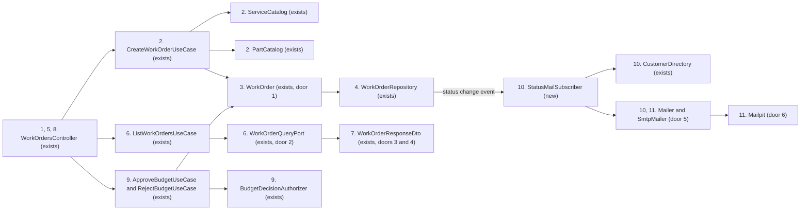
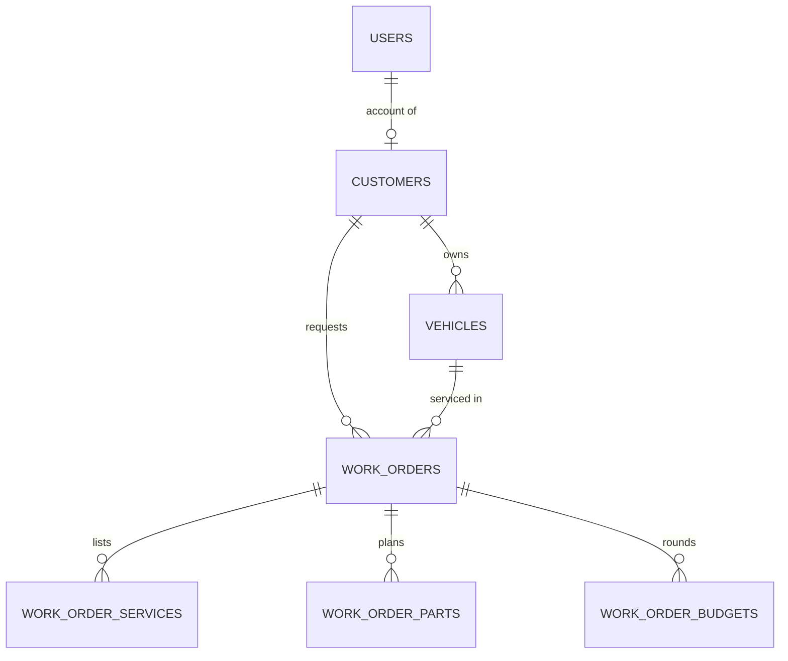
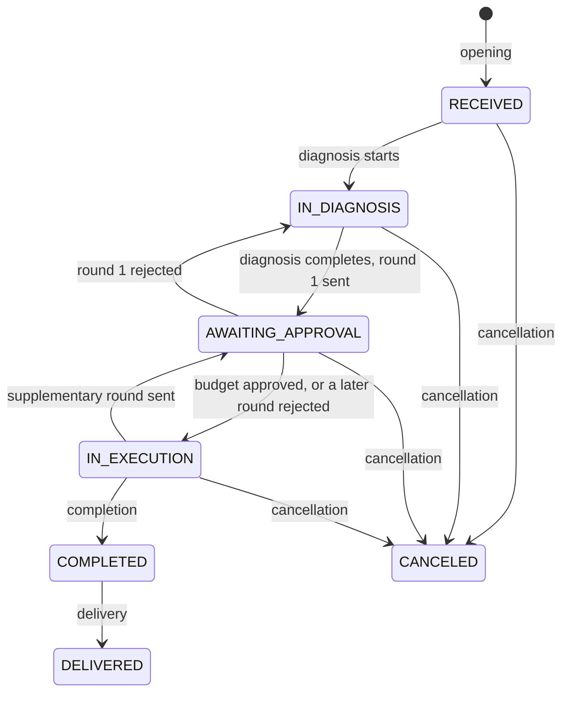

# Work order Phase 2 API

**Approved**: 2026-11-01 - user: "Sim"

## Problem

Opening a work order takes one call with the customer's and the vehicle's ids, then one call per service and one per part, and a part can only be planned once the diagnosis starts. A customer who arrives asking for a specific replacement, such as new brake pads, cannot have it recorded at reception. The approval and the rejection of a budget exist only as routes the client app calls on its own initiative; nothing reaches the customer to tell them a budget waits for them, or hands them the way to decide it. The staff board lists every work order newest first, the completed, delivered and canceled ones included, with no pagination, so the work in progress sits among closed orders and the answer grows with every order ever opened. The status comes back as a code (`IN_DIAGNOSIS`) where the brief names it in Portuguese ("Diagnóstico"). A customer learns that a work order changed status only by asking the workshop or calling the API.

Evidence: the Phase 2 brief, page 3, "Alterar/criar as seguintes APIs", and page 5, "Link para a collection completa das APIs (Postman, Swagger ou Similar)". The brief gives no usage figures.

When this ships, the front desk opens a work order with the services and parts the customer asked for in one call, the customer receives an e-mail at every status change, the e-mail of a budget carries the links that approve or reject it, the board shows the work in progress first, oldest first, one page at a time, every work order answer names its status in Portuguese, and the README and the Postman collection cover all of it.

## Shape

This reuses the work order aggregate's own item rules (`addService`, `planPart`, `removeItem`), the existing budget decisions and their authorizer, the in-process domain event dispatcher for side effects (AD-016), and the work-orders query adapter for the listing. The rules that change an outcome (parts at `RECEIVED`, the order and the default exclusion of the listing, the pagination bounds, the budget a link may decide, which change sends which e-mail, the status labels) run in the domain, the application use cases, the query adapter and one presentation mapper, all reached by the unit and integration suites.

Opening:

1. POST /work-orders with the customer id, the vehicle id and optional services and parts -> `WorkOrdersController` (exists) - validates the body and hands one command on
2. `CreateWorkOrderUseCase` (exists) - checks the customer and the vehicle as today, resolves every service through `ServiceCatalog` (exists) and every part through `PartCatalog` (exists), and opens the aggregate with its items in memory, so one invalid item stops the opening before anything is saved
3. `WorkOrder` (exists) - plans a part at RECEIVED too (door 1), and records the opening, the item events and one status change event per transition
4. `WorkOrderRepository` (exists) - persists the work order and its items in one transaction; out: 201 with the id and the number

Listing:

5. GET /work-orders with page, pageSize and an optional status -> `WorkOrdersController` (exists) - refuses a missing or out-of-range page or pageSize and an unknown status with 400
6. `ListWorkOrdersUseCase` (exists) -> `WorkOrderQueryPort` (exists) - the query adapter keeps the open statuses when no status is given, orders by status rank and then oldest first, counts the total and answers the page envelope (door 2)

Every work order answer:

7. `WorkOrderResponseDto` (exists) - gains the status label from one map (door 3) and the decision links on the pending budget (door 4)

Budget decision by link:

8. POST to a budget's approval or rejection link with the customer's Bearer token -> `WorkOrdersController` (exists) - a route pair beside the round-less pair (door 4)
9. `ApproveBudgetUseCase` and `RejectBudgetUseCase` (exists) - take the budget id, apply `BudgetDecisionAuthorizer` (exists) as today, refuse a budget the work order does not have (404) or that is not pending (422), and decide as today

Status e-mails:

10. `StatusMailSubscriber` (new) - receives the status change event the use case published after the commit, reads the customer's name and e-mail through `CustomerDirectory` (exists), composes the Portuguese message, with the budget total and both links when the status is AWAITING_APPROVAL, and hands it to `Mailer` (door 5)
11. `SmtpMailer` (door 5) - sends through the configured server, Mailpit (door 6) in local development; a failure is caught and logged at error level with the work order number, and never reaches the request
12. out: ADRs 0034 to 0037, the README, the work-orders low-level design and the Postman collection describe the opening with items, the labels, the listing, the links and the e-mails

**Changes underneath**

| Front | What changes |
| --- | --- |
| domain | `planPart` meant "in diagnosis or execution only", now also `RECEIVED` - `PART_PLANNABLE_STATES` in `work-order.ts`, `POST /work-orders/:number/parts`, and the unit and e2e cases that expect a part refused at `RECEIVED` |
| domain | every status transition also records one status change event (new); the trail stays as it is, since the event feeds no `work_order_events` row |
| stored data | nothing to migrate: no table or column changes |
| readers | `GET /work-orders` answers an envelope and requires `page` and `pageSize`: the e2e case `test/e2e/work-orders.e2e.spec.ts:290`, the collection's `GET /work-orders?status=DELIVERED`, and an unknown status, which answered 200 with an empty list and now answers 400 |
| readers | every work order answer gains `statusLabel`, `approvalUrl` and `rejectionUrl`: the e2e cases that read work orders, the collection, and `test/contract/openapi.baseline.json`, regenerated with the new routes, fields and parameters |
| readers | the customer receives e-mails; `.env.example`, `.env.test` and `docker-compose.yml` gain the mail settings and the Mailpit service |

New: nothing - no table, column or relation changes. One-way constraints: none.

Every transition above, the opening included, sends the customer one e-mail.

## Surface

| Route | In | Out | Status | Who |
| --- | --- | --- | --- | --- |
| `POST /api/v1/work-orders` | `customerId`, `vehicleId`, optional `services: [{ serviceId }]`, optional `parts: [{ inventoryItemId, quantity }]` | `{ id, number }` | 201; 400 invalid body; 404 customer, vehicle, service or inventory item not found; 409 vehicle already has an active work order; 422 customer inactive, vehicle not owned by the customer, service or item inactive; 401 without a token, 403 without `work-orders:manage` | holders of `work-orders:manage` |
| `GET /api/v1/work-orders` | `page` (integer, 1 or more) and `pageSize` (integer, 1 to 100), both required; optional `status`, one or more of the seven statuses separated by commas | `{ items: [work order], page, pageSize, totalItems, totalPages }` | 200; 400 `VALIDATION_ERROR` for a missing or out-of-range `page` or `pageSize` or an unknown status; 401 without a token, 403 without `work-orders:read` | holders of `work-orders:read` |
| `POST /api/v1/work-orders/:number/budgets/:budgetId/approval` | none | the work order | 200; 404 `WORK_ORDER_NOT_FOUND` for an unknown number and for a caller who is neither the owning customer nor a holder of `work-orders:decide`; 404 `WORK_ORDER_BUDGET_NOT_FOUND` for a budget the work order does not have; 422 `BUDGET_INVALID_STATE` for a budget that is not pending; 401 without a token | the owning customer, or a holder of `work-orders:decide` |
| `POST /api/v1/work-orders/:number/budgets/:budgetId/rejection` | none | the work order | 200; 404 `WORK_ORDER_NOT_FOUND` for an unknown number and for a caller who is neither the owning customer nor a holder of `work-orders:decide`; 404 `WORK_ORDER_BUDGET_NOT_FOUND`; 422 `BUDGET_INVALID_STATE`; 401 without a token | the owning customer, or a holder of `work-orders:decide` |
| every route that answers a work order (`GET /work-orders/:number`, `GET /work-orders/me`, `GET /work-orders/me/:number`, the transitions) | unchanged | the work order gains `statusLabel`, and each budget gains `approvalUrl` and `rejectionUrl`, null unless the budget is pending | 200; 401 without a token; 403 or 404 for a caller each route refuses today | the callers each route allows today |

## Landing

| One-way door | Literal shape | Alternative rejected |
| --- | --- | --- |
| 1. Parts at reception | `PART_PLANNABLE_STATES = [RECEIVED, IN_DIAGNOSIS, IN_EXECUTION]`; AD-018, ADR 0034 | A separate "requested part" kind with its own table: the user wants the customer's choice in the flow that already edits items, and the diagnosis already removes what it does not confirm |
| 2. The listing's page envelope | `GET /work-orders?page=1&pageSize=20` answers `{ "items": [...], "page": 1, "pageSize": 20, "totalItems": 135, "totalPages": 7 }`; a page past the last answers 200 with `"items": []`; AD-019, ADR 0035, the shape a later paginated listing copies | `limit` and `offset` with an array and an `X-Total-Count` header, and a cursor: the user chose the envelope |
| 3. Status labels | `RECEIVED` "Recebida", `IN_DIAGNOSIS` "Diagnóstico", `AWAITING_APPROVAL` "Aguardando Aprovação", `IN_EXECUTION` "Execução", `COMPLETED` "Finalizada", `DELIVERED` "Entregue", `CANCELED` "Cancelada", in the field `statusLabel` | Labels only in the docs: the user asked for the label beside the code in the answer |
| 4. Budget decision links | `${APP_PUBLIC_URL}/api/v1/work-orders/${number}/budgets/${budgetId}/approval` and `.../rejection`, called with POST and the customer's Bearer token; `APP_PUBLIC_URL` defaults to `http://localhost:13000` | Links to the existing `/budget/approval` and `/budget/rejection`: they decide whichever round is pending, so an older e-mail would decide a round the customer never saw |
| 5. A mail dependency | `nodemailer` over SMTP behind a `Mailer` port owned by `work-orders`; settings `SMTP_HOST`, `SMTP_PORT`, `SMTP_USER`, `SMTP_PASSWORD`, `MAIL_FROM`; AD-020, ADR 0036 | A provider's HTTP API (SendGrid, Resend): an account and a key even for a local run, and code tied to one vendor |
| 6. A local mail catcher | an `axllent/mailpit` service in `docker-compose.yml`, SMTP on port 1025 and the web inbox on port 8025 | No local server: every e-mail would fail and log an error on a developer's machine, and the demo would show no e-mail |

- Nothing else in this change is hard to reverse

## Criteria

### S1: Open a work order with the customer's services and parts (P1)

The front desk records, in the opening call, what the customer asked for.

**Acceptance Criteria**

1. WHEN a holder of `work-orders:manage` sends `POST /work-orders` with `customerId`, `vehicleId`, `services` and `parts` THEN the system SHALL answer 201 with `{ id, number }`, and the work order SHALL be `RECEIVED` with one draft service item per service and one draft part item per part, with the quantity sent
   - two services and one part of quantity 2 → three items, each with `budgetRound` null and the part's `plannedQuantity` 2; no `services` and no `parts` → a work order with no items, as today
2. IF a service or a part of the opening is unknown or inactive THEN the system SHALL answer with the code the separate routes answer for it, and SHALL create no work order
   - the third of three services unknown → 404 `WORK_ORDER_REFERENCED_SERVICE_NOT_FOUND`, and the vehicle still has no active work order; an inactive inventory item → 422 `WORK_ORDER_INVENTORY_ITEM_INACTIVE`
3. IF a part of the opening has a quantity below 1, or an item of either list lacks its id THEN the system SHALL answer 400 `VALIDATION_ERROR` and create no work order
   - quantity 0 → 400; quantity 1 → accepted
4. WHEN a part is planned through `POST /work-orders/:number/parts` on a `RECEIVED` work order THEN the system SHALL plan it as a draft item
   - `RECEIVED` → planned; `COMPLETED` → 422 `WORK_ORDER_INVALID_STATE`, as today
5. WHEN the diagnosis of a work order opened with items completes THEN round 1 of the budget SHALL hold the items still on the work order
   - opened with services A and B and part P, then B removed and service C added during the diagnosis → round 1 holds A, C and P, and not B

### S2: The staff board, by status and one page at a time (P1)

The work in progress comes first, oldest first, and closed orders appear only when asked for.

**Acceptance Criteria**

6. WHEN `GET /work-orders` carries `page` and `pageSize` and no `status` THEN the system SHALL return only `IN_EXECUTION`, `AWAITING_APPROVAL`, `IN_DIAGNOSIS` and `RECEIVED` work orders, in that order of status and oldest first within each status
   - one work order in each of the seven statuses → the four open ones, `IN_EXECUTION` first and `RECEIVED` last, with `totalItems` 4; two `RECEIVED` created a minute apart → the older first
7. WHEN `status` names one or more statuses THEN the system SHALL return the work orders in exactly those statuses, ordered `IN_EXECUTION`, `AWAITING_APPROVAL`, `IN_DIAGNOSIS`, `RECEIVED`, `COMPLETED`, `DELIVERED`, `CANCELED`, oldest first within each
   - `status=CANCELED,DELIVERED` → the delivered ones before the canceled ones and nothing else; `status=COMPLETED` → completed ones only
8. The system SHALL answer the listing as `{ items, page, pageSize, totalItems, totalPages }`, with at most `pageSize` items, `totalPages` the total divided by `pageSize` rounded up, and 0 pages for no match
   - 5 matches, `pageSize` 2 → pages 1 and 2 hold 2 items, page 3 holds 1, `totalPages` 3; page 4 → 200 with `items` empty, `totalItems` 5, `totalPages` 3; no match → `totalItems` 0, `totalPages` 0
9. IF `page` or `pageSize` is missing or out of range, or `status` names an unknown status THEN the system SHALL answer 400 `VALIDATION_ERROR`
   - no `pageSize` → 400; `pageSize` 101 → 400; `pageSize` 100 → 200; `page` 0 → 400; `status=FOO` → 400; `status=RECEIVED,FOO` → 400

### S3: The status named in Portuguese (P2)

Every work order answer names its status as the brief does.

**Acceptance Criteria**

10. The system SHALL answer every work order with `statusLabel` beside `status`: `RECEIVED` "Recebida", `IN_DIAGNOSIS` "Diagnóstico", `AWAITING_APPROVAL` "Aguardando Aprovação", `IN_EXECUTION` "Execução", `COMPLETED` "Finalizada", `DELIVERED` "Entregue", `CANCELED` "Cancelada"
    - all seven pairs, on the detail, on the customer's routes and on the listing

### S4: The customer decides a budget through its links (P1)

The pending budget carries the links that decide it, and only its own customer can use them.

**Acceptance Criteria**

11. WHILE a budget is pending, the system SHALL answer it, in every work order answer, with `approvalUrl` `${APP_PUBLIC_URL}/api/v1/work-orders/${number}/budgets/${budgetId}/approval` and `rejectionUrl` ending in `/rejection`, and SHALL answer null in both on every other budget
    - round 1 pending → both URLs on round 1; round 1 approved and round 2 pending → null on round 1, URLs on round 2
12. WHEN the owning customer sends `POST` to the `approvalUrl` of the pending budget with their Bearer token THEN the system SHALL approve that budget, move the work order to `IN_EXECUTION` and record the customer as the decider
13. WHEN the owning customer sends `POST` to the `rejectionUrl` of the pending budget THEN the system SHALL reject it as `POST /budget/rejection` does
    - round 1 → `IN_DIAGNOSIS`; round 2 → `IN_EXECUTION`
14. IF the link's budget is not pending THEN the system SHALL answer 422 `BUDGET_INVALID_STATE` and change nothing
    - round 1's approval link after round 1 was approved and round 2 sent → 422, and round 2 stays pending
15. IF the link's budget is not one of the work order's THEN the system SHALL answer 404 `WORK_ORDER_BUDGET_NOT_FOUND`; IF the caller is neither the owning customer nor a holder of `work-orders:decide` THEN 404 `WORK_ORDER_NOT_FOUND`; without a token, 401
    - another work order's budget id → 404 `WORK_ORDER_BUDGET_NOT_FOUND`; another customer's token → 404 `WORK_ORDER_NOT_FOUND`

### S5: The customer hears of every status change by e-mail (P1)

The customer learns of each change without asking.

**Acceptance Criteria**

16. WHEN a work order is opened, or its status changes THEN the system SHALL send its customer one e-mail, to the customer's address, with the subject `Ordem de serviço ${number}: ${statusLabel}` and a body that names the customer, the work order number, the vehicle plate and the new status label
    - opening → "Recebida"; round 1 rejected → one e-mail "Diagnóstico"; approval → one e-mail "Execução", though the approval records two events; cancellation → "Cancelada"
17. WHEN the new status is `AWAITING_APPROVAL` THEN the e-mail SHALL also carry the budget total in reais and the `approvalUrl` and `rejectionUrl` of the pending budget
    - round 1 and a supplementary round each send their own links
18. IF sending an e-mail fails THEN the request that changed the status SHALL answer as it would with no e-mail, and the system SHALL log at error level the work order number and the error
    - the mail server refuses the message → the transition answers 200 and the status is saved
19. WHEN a status change does not happen THEN the system SHALL send no e-mail
    - a refused transition (422) → no e-mail; adding an item without a status change → no e-mail

## Out of scope

| Excluded | Why |
| --- | --- |
| Kubernetes manifests, Terraform, the CI/CD pipeline and the video | Separate Phase 2 deliveries, planned on their own |
| Opening with the customer's and the vehicle's data, registering what is missing | The registration routes already exist; the user chose the ids |
| A machine-to-machine webhook with its own credentials | The user chose the e-mail links used with the customer's token |
| A page or screen behind the budget links | No front end exists; the links are API calls |
| Sending a failed e-mail again | The user chose to log the failure |
| Pagination on the other listings, the customer's own listing included | The user scoped pagination to `GET /work-orders`, and `GET /work-orders/me` stays as it is |
| Changing an item's quantity in place | Removing the item and adding it again already does it |
| An automated proof of the Postman collection | The user checks the collection by hand at the end of each feature |

## Assumptions

| Assumption | Chosen default | Rationale | Confirmed? |
| --- | --- | --- | --- |
| How the opening identifies the customer and the vehicle | The ids of records already registered, as today | user: "Se atualmente temos rotas para cadastrar veiculos, clientes e afins - já estamos cobrindo os requisitos. Basta que seja informado os ids dos clientes. O foco desse requisito é permitir criar a ordem de serviço e isso já fazemos" | y |
| Parts before the diagnosis | A part can be planned while the work order is `RECEIVED`, so the customer can ask for a replacement with no diagnosis | user: "A nossa lógica para ordem de serviço é que a peça seja definida durante o diagnostico. Mas podemos flexibilizar para permitir que o cliente opte por trocar peças mesmo sem diagnostico. Eu sou o cliente, quero trocar as pastilhas de freio e posso solicitar que isso seja feito mesmo sem ter um problema nas pastilhas em uso por exemplo." | y |
| How the customer's choice of services and parts enters the opening | `POST /work-orders` takes optional `services` and `parts`; each becomes a draft item, as if added by `POST /services` or `POST /parts` right after the opening; the mechanic removes or adds items during the diagnosis, and the budget generated at its end is what the customer approves; one invalid item refuses the whole opening | user chose "Itens comuns na abertura (Recomendado)" | y |
| The status lookup | No new route: the existing work order routes already return the status; the docs and the collection describe them, and every work order answer gains a Portuguese label beside the code | user: "Podemos apenas documentar isso se não estiver documentado (docs e collection). E podemos fazer uma melhoria, retornar um label em pt/br além do código ou enum" | y |
| The staff listing's default and its filters | With no filter, the brief's order, oldest first, without completed, delivered and canceled orders; filters change that, canceled orders included; the listing is paginated and its pagination parameters are required | user: "Podemos fazer a ordenaçãp sugerida como padrão, mas permitir que o usuário utlize filtros para mudar o comportamento (o mesmo se aplica para as canceladas). Se não tivermos paginação, devemos aplicar e os parametros de paginação devem ser obrigatórios" | y |
| The pagination contract | `page` (from 1) and `pageSize` (1 to 100) are required; the answer is `{ items, page, pageSize, totalItems, totalPages }`; a call without them gets 400 | user chose "page e pageSize, envelope (Recomendado)" | y |
| Which listings get the pagination | Only the staff listing, `GET /work-orders` | user chose "Só GET /work-orders (Recomendado)" | y |
| The status filter and the order of closed orders | `?status=` takes one or more statuses separated by commas; the order is `IN_EXECUTION` > `AWAITING_APPROVAL` > `IN_DIAGNOSIS` > `RECEIVED` > `COMPLETED` > `DELIVERED` > `CANCELED`, oldest first within each | user chose "Vários status, ordem estendida (Recomendado)" | y |
| How the brief's "notificações externas de aprovação ou recusa do orçamento do cliente" is met | The e-mail of a budget awaiting approval carries an approval link and a rejection link for that budget; using one requires the customer's own Bearer token; the collection runs the flow up to the customer's login and the approval through the generated link; the customer is recorded as the decider | user: "A ideia aqui é na verdade que o usuário possa aprovar de alguma forma. Podemos seguir por enquanto com a lógica de email + link que exige autenticação mesmo que não tenhamos um portal ou tela. Basta documentarmos isso nas docs e termos um cenário na collection que contemple login + confirmação via link (o link deve ser gerado pelo fluxo de aprovação - a ideia é que o cenário cubra toda a etapa até chegar na parte de login do cliente + aprovação com link gerado de forma dinamica e uso do Bearer token do cliente)" | y |
| Where the collection reads the generated link | From the API: every work order answer carries the pending budget's `approvalUrl` and `rejectionUrl`, the same URLs the e-mail carries | user chose "Da resposta da API" | y |
| Which budget a link decides | The budget the link names, by id; a budget that is no longer pending refuses the link; the round-less routes stay as they are | user chose "O orçamento do e-mail (Recomendado)" | y |
| Which status changes send an e-mail | The opening and every status change after it | user chose "Em toda mudança (Recomendado)" | y |
| A status e-mail that fails | The failure is logged at error level and never fails the request; the e-mail is not sent again | user chose "Registra no log (Recomendado)" | y |
| The customer's own listing, `GET /work-orders/me` | Unchanged | user chose "Fica como está (Recomendado)" | y |
| How the Postman collection is checked | By hand at the end of each feature, as today; no automated proof | user: "Verificação manual apenas a cada feature como estamos fazendo, nada automatizado" | y |
| The label of `CANCELED` | "Cancelada" | The brief names the six other statuses only; this follows their wording | n |
| The e-mail's language and form | Portuguese, plain text with an HTML version, the subject `Ordem de serviço ${number}: ${statusLabel}`, sent from `MAIL_FROM` (default `Oficina <no-reply@workshop.local>`) | The customers are Brazilian, and the brief names the statuses in Portuguese | n |
| The mail settings at boot | Required by the environment validation like the other settings; `.env.example` points at Mailpit; the test suites replace the `Mailer` with a fake that records what it was asked to send | A missing setting fails at boot instead of at the first e-mail, and no suite needs a mail server | n |
| `APP_PUBLIC_URL` | Required, default `http://localhost:13000` in `.env.example` | It is the host port `docker-compose.yml` publishes today | n |

**Open questions:** none - all resolved or logged above.

## Differences from the source

| Source shows | Product shows | Confirmed |
| --- | --- | --- |
| "Abertura de Ordem de Serviço (OS): receber os dados do cliente, veículo, serviços e peças" | The opening receives the ids of a customer and a vehicle already registered, plus the services and parts to plan; the registration routes take the customer's and the vehicle's data | y - AD-021 |
| "Aprovação de orçamento: endpoint para receber notificações externas de aprovação ou recusa do orçamento do cliente" | The e-mail of a pending budget carries its approval and rejection links, which the customer calls with their own Bearer token; no system-to-system endpoint | y - AD-021 |
| "Consulta de status da OS: informar a situação atual da OS (Recebida, Diagnóstico, Aguardando Aprovação, Execução, Finalizada, Entregue)" | The existing work order routes answer the status code with its Portuguese label; no route of its own | y - AD-021 |

## Sources

- `/home/kewin/Desktop/fiap/fase_2/SOAT - Fase 2 - Tech challenge.pdf`, read on 2026-11-01 - binding - page 3 lists the five API changes; page 5 requires the README to link a complete API collection
