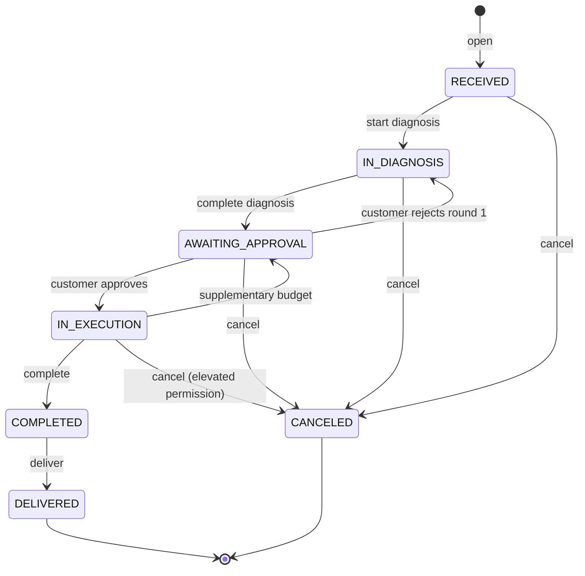
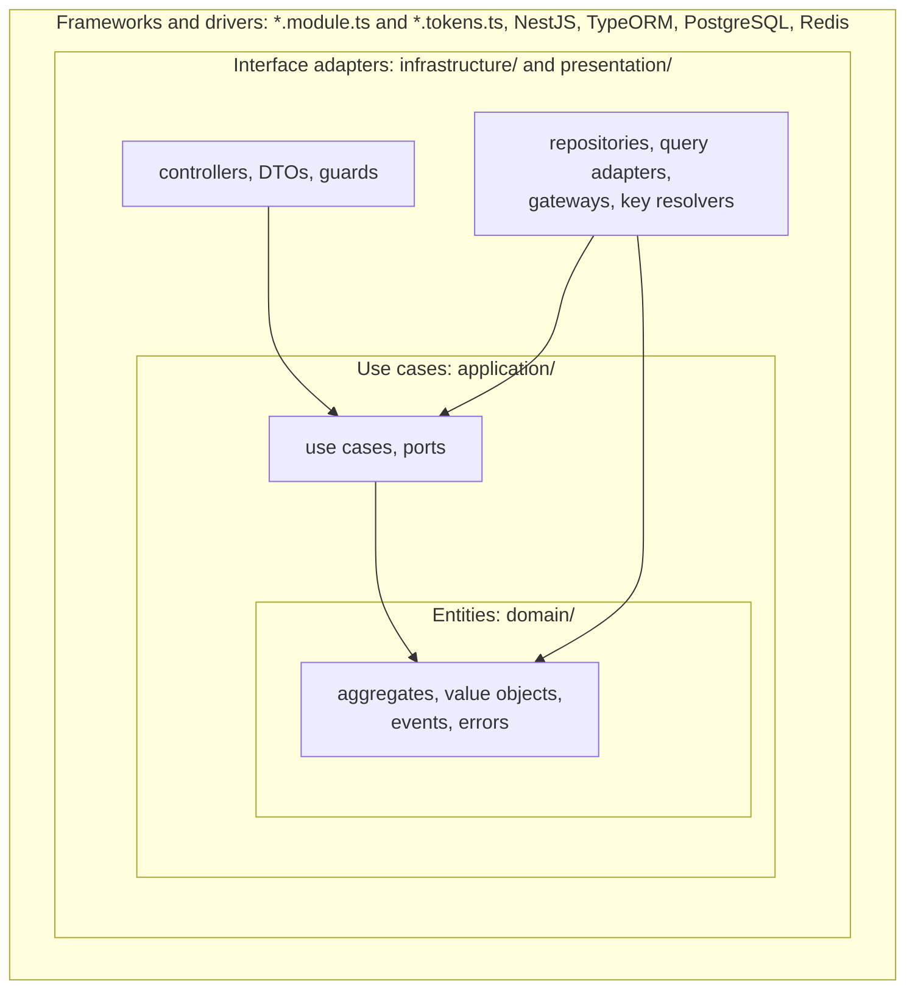
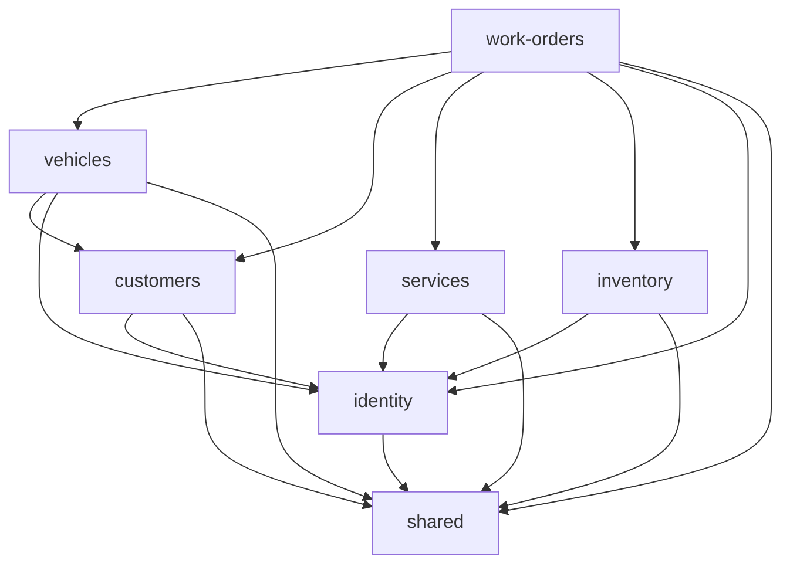
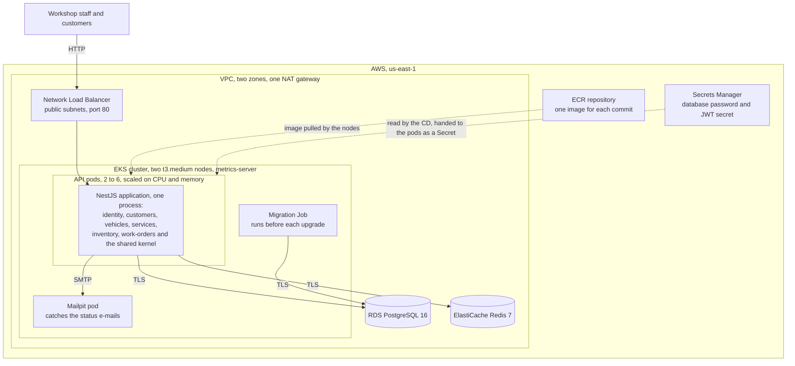
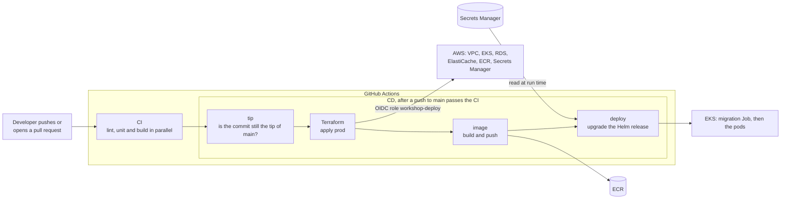

# Workshop Management API

A REST API for running an auto repair shop, from the moment the vehicle arrives to the moment it
is handed back.

[](LICENSE)
[](https://nodejs.org)
[](https://nestjs.com)
[](https://www.postgresql.org)

> **Status:** MVP under active development. The features described below are implemented, covered
> by tests and verified by git hooks on every commit and push. The repository holds what it takes to
> run the project on AWS ([Phase 2 infrastructure](#phase-2-infrastructure)), and the project has
> never run in production.

## Contents

- [Overview](#overview)
- [Features](#features)
- [Architecture](#architecture)
- [Phase 2 infrastructure](#phase-2-infrastructure)
  - [The solution and its goals](#the-solution-and-its-goals)
  - [The architecture](#the-architecture)
  - [Running locally](#running-locally)
  - [Provisioning with Terraform](#provisioning-with-terraform)
  - [The CI and the CD](#the-ci-and-the-cd)
  - [Deploying to Kubernetes](#deploying-to-kubernetes)
  - [The prod database](#the-prod-database)
  - [Showing the autoscaler](#showing-the-autoscaler)
  - [The API collection and the video](#the-api-collection-and-the-video)
- [Tech stack](#tech-stack)
- [Requirements](#requirements)
- [Getting started](#getting-started)
- [Environment variables](#environment-variables)
- [Database](#database)
- [Running the application](#running-the-application)
- [API](#api)
- [Postman collection](#postman-collection)
- [Testing](#testing)
- [Code quality](#code-quality)
- [Project structure](#project-structure)
- [Conventions](#conventions)
- [Ubiquitous language](#ubiquitous-language)
- [Technical decisions](#technical-decisions)
- [Challenge requirements](#challenge-requirements)
- [Security](#security)
- [Security assessment](#security-assessment)
- [Deployment](#deployment)
- [Contributing](#contributing)
- [License](#license)

## Overview

A small repair shop runs the same cycle every day: a car arrives, someone diagnoses it, the
customer has to approve the cost before the work starts, parts leave the shelf while the service
happens, and at the end somebody needs to know what was charged and why. Without a system this
lives in paper and spreadsheets, the customer calls to ask about the car and nobody can answer,
and the stock is only checked when something runs out.

This API centres that operation on one concept: the **work order**. It holds who the customer is,
which vehicle it is, what was diagnosed, what it costs, who approved it, which parts left the
shelf and when the car was delivered. Every status change happens as the consequence of an action,
never through a direct write, and every step is recorded in a trail that cannot be rewritten.

**Who it is for:** developers building or evaluating a repair shop backend, and anyone who wants a
concrete example of a modular monolith with DDD and Clean Architecture in NestJS. It is an HTTP API:
there is no user interface in this repository.

**Why it exists:** it started as the Tech Challenge of the postgraduate program in Software
Architecture at FIAP (SOAT). The scope is a single shop, with one stock and one address. It does
not cover invoicing, supplier management or scheduling. Phase 2 of the challenge adds the
infrastructure: the application runs on Kubernetes, Terraform provisions the cluster and the database
on AWS, and a GitHub Actions pipeline builds, tests and deploys it
([Phase 2 infrastructure](#phase-2-infrastructure)).

## Features

### Identity and access

- Account registration on a public route, with CPF and CNPJ validated by check digit
- JWT authentication with an access token and a single-use rotating refresh token
- Sessions that can be listed and revoked, one at a time or all at once
- Staff accounts created with a temporary password, locked until the first change
- Permission-based access control, grouped into roles: `SUPER_ADMIN`, `ADMIN`, `SERVICE_ADVISOR`,
  `MECHANIC`, `CUSTOMER`
- Rate limiting through Redis, with a tighter band on the authentication routes

### Customers and vehicles

- Customer CRUD, with the address checked against the real list of Brazilian states and the phone
  number normalised
- Customer lookup by name or by document, which is how the counter works
- Vehicle CRUD with plates in the old (AAA0000) and Mercosul (AAA0A00) formats
- Vehicle transfer between customers
- `me` routes for the customer to read and update their own record

### Service catalog

- Service CRUD with a price and an estimated duration
- Logical deletion: the record stays and the name becomes available again

### Inventory

- Part and supply CRUD, with the SKU unique among active items
- Replenishment and downward adjustment, each writing a movement
- A count that never goes negative, changed only by a movement
- Append-only movement history, with the actor of each one
- Shortage report: items whose demand from orders in execution exceeds what is on the shelf
- Deactivation refused while an open work order still plans the item

### Work orders

- Opened from the customer and the vehicle, with one vehicle per open order, carrying the services and parts the customer asks for
- Catalog services and inventory parts added to the order, parts from the reception on
- Budget summed inside the aggregate, from the services and the planned parts
- Numbered budget rounds, for extra work found during execution
- Approval or rejection by the customer, or by whoever holds the permission to decide, through the links the pending budget carries
- Part withdrawal from stock, consumed first and given back when the order cannot be saved
- Return of what was left over, cancellation with a definitive write-off, discount with a reason
- A board that lists the work in progress first and oldest first, one page at a time, and leaves the finished orders out unless a filter asks for them
- Every work order answer names its status in Portuguese beside the code
- An e-mail to the customer at the opening and at every status change, with the total and the links that decide the budget when it awaits approval
- Seven states, changed only as the consequence of an action:



### Tracking and metrics

- The customer reads their own orders through the API, with no access to anyone else's
- Full work order trail, written in the same transaction that changes the aggregate
- Average execution time, filterable by service and by period

## Architecture

A modular monolith in layers, in a single process against a single database. It has six modules and
a shared kernel, and each module has four layers. Two rules hold it together. Source dependencies
point inward, and a module reaches another only through a port it declares and the public API of
the other.

### The dependency circles

The business rules sit at the center and import nothing from the circles around them. Each circle
is a folder in every module, and each arrow is an import:



The business rules live in the aggregates. What decides whether a work order can leave the
diagnosis is `WorkOrder` itself, and what guarantees the stock never goes negative is the
`StockQuantity` value object. A use case loads an aggregate through a repository port, calls a
method on it and saves it. A controller turns the request into a `<Name>Command` or `<Name>Query`,
calls the use case class directly and turns the result into the response.

Each module's composition root, `<module>.module.ts`, builds every use case with its collaborators
and binds every port to its adapter. It is the one place that knows Nest's container and every
concrete class. The `identity` module keeps its three areas, `users`, `authentication` and
`authorization`, each with the same four folders, under one Nest module. Every request passes the
global guard chain before it reaches a controller, which
[the high level design](docs/architecture/high-level-design.md) describes.

**Tactical patterns in use**, with real examples:

| Pattern             | Where it lives                                                                                   |
| ------------------- | ------------------------------------------------------------------------------------------------ |
| Aggregate           | `WorkOrder`, `InventoryItem`, `Customer`, `Vehicle`, `Service`, `User`                           |
| Child entity        | `Budget`, `WorkOrderPartItem`, `StockMovement` (inside the aggregate that creates them)          |
| Value object        | `PersonDocument`, `LicensePlate`, `Money`, `StockQuantity`, `WorkOrderNumber`                    |
| Domain event        | `BudgetGenerated`, `StockReplenished`, `VehicleDelivered`                                        |
| Use case            | `CreateWorkOrderUseCase`, one class per operation, with one `execute` method                     |
| Repository          | Contract in `application/ports`, TypeORM implementation in `infrastructure`                      |
| Application service | `BudgetDecisionAuthorizer`, `WorkOrderCompletionAuthorizer`                                      |
| Port and adapter    | `InventoryQueryPort`, `Clock`, `IdGenerator`, `TransactionRunner`                                |
| Gateway             | `CustomerDirectory` is a port of `work-orders`, and `CustomerDirectoryGateway` calls `customers` |
| Key resolver        | `UserKeyResolver` and four more, turning a UUID into an internal key for the other modules       |

The five bounded contexts are Identity & Access, Customer Management, Workshop Catalog, Inventory
and Workshop Operations. Identity & Access is the `identity` module, and Customer Management spans
`customers` and `vehicles`.

### The module dependency graph

Each arrow is an import of one module by another, and the graph has no cycle. `shared` imports no
module, and `identity` imports only `shared`:



dependency-cruiser draws the same graph from the code:

```bash
npx depcruise src --include-only "^src/(modules|shared)/" \
  --collapse "^src/(modules/[^/]+|shared)" --output-type mermaid
```

A module reaches another in one way. It declares a port in its own `application/ports`, implements
the port in its own `infrastructure/gateways`, and the gateway calls the use cases the other module
exports from its `index.ts` ([ADR 0027](docs/adr/0027-ports-between-modules.md)). `work-orders` reads
a customer this way: its `CustomerDirectory` port is implemented by a gateway that calls `customers`.

One pair needs the inverse. `work-orders` calls `inventory` to move stock, and `inventory` needs work
order data for the shortage report and the in-use check. `inventory` declares the `WorkOrderReads`
interface, `work-orders` implements it, and a global `WorkOrderReadsModule` binds the two at the
root, so the arrow between the two modules stays one way.

Each module also queries only its own tables. A repository that has to turn another module's UUID
into an internal key asks that module's key resolver, and data another module owns comes through its
public API ([ADR 0028](docs/adr/0028-each-module-queries-only-its-own-tables.md)).

### Writes across modules

A transaction writes the tables of one module only. A flow that writes two modules runs as steps,
and each module commits its own. The module that orchestrates the flow keeps an outbox table of its
own, `work_order_stock_steps` in `work-orders` and `customer_account_steps` in `customers`, and a
processor applies the steps that are due. Withdrawing a part arms an undo step, consumes the stock
in `inventory`, and then, in one transaction, closes the step, saves the work order and records a
confirmation step, which the request applies after the commit. When the save fails, the request gives the units back at once, and when the process stops in between, the
processor gives them back after a grace period. A return, a delivery and a cancellation save the
work order and record the stock step together, apply it after the commit, and leave a failed
attempt to the processor, which retries it with a growing delay. Those steps count only the
consumptions a work order confirmed, so the consumption of a withdrawal in flight belongs to its undo
alone. The registration of a customer
with a new account follows the withdrawal: it arms a discard step, opens the account in `identity`,
and then saves the customer. Every receiving step is idempotent by operation id
([ADR 0033](docs/adr/0033-writes-across-modules-run-as-steps.md)).

### What `npm run lint` enforces

`npm run lint` runs ESLint and then `npm run lint:architecture`. It exits non-zero on any of these
and names the file and the rule:

| Rule              | It fails when                                                                                                                                                                                                                                                       | Checked by                                                                           |
| ----------------- | ------------------------------------------------------------------------------------------------------------------------------------------------------------------------------------------------------------------------------------------------------------------- | ------------------------------------------------------------------------------------ |
| Core purity       | A file under `domain/` or `application/`, specs included, imports `@nestjs/*`, `typeorm`, `ioredis`, `argon2`, `pg`, `express`, `class-validator`, `class-transformer`, `zod`, `rxjs` or a `node:*` module, carries a decorator or declares a token with `Symbol()` | ESLint, and `core-no-frameworks` in dependency-cruiser                               |
| Layer direction   | `domain/` or `application/` imports `infrastructure/` or `presentation/`, or `domain/` imports `application/`                                                                                                                                                       | dependency-cruiser, `inward-only`                                                    |
| Module boundaries | A `domain/` or `application/` file imports another module, a module imports another without going through its `index.ts`, or `src/shared` imports a module                                                                                                          | dependency-cruiser, `core-stays-in-module`, `through-public-api`, `shared-is-a-leaf` |
| Cycles            | Files import one another in a loop, or modules depend on one another in a cycle                                                                                                                                                                                     | dependency-cruiser, `no-circular`, and `scripts/architecture/check-module-cycles.ts` |
| Table ownership   | An adapter's SQL names a table another module owns, a table the owner map does not list, or a table name built at runtime                                                                                                                                           | `scripts/architecture/check-table-ownership.ts`                                      |

The two lists of tolerated violations, `.dependency-cruiser-known-violations.json` and
`scripts/architecture/known-table-findings.json`, are empty, and a test keeps them so. A test in
`test/architecture/` proves each rule against a fixture tree that breaks it. The `pre-push` hook runs
`npm run lint`.

Details in [`docs/architecture/`](docs/architecture/):
[overview](docs/architecture/architecture-overview.md),
[high level design](docs/architecture/high-level-design.md),
[low level design per module](docs/architecture/low-level-design/README.md).

The vocabulary of each context, with the translation between the business term and the code term,
is in [`docs/ubiquitous-language/`](docs/ubiquitous-language/README.md).

## Phase 2 infrastructure

The second phase of the Tech Challenge moves the application from one machine to a Kubernetes
cluster. This section describes the solution and its goals, draws the architecture, and gives the
commands to run it locally, provision it, deploy it and reach its database.
[`infra/README.md`](infra/README.md) holds the detail of Terraform, and
[`k8s/README.md`](k8s/README.md) the detail of the chart.

### The solution and its goals

The brief of Phase 2 asks for the application in a container, deployed to Kubernetes with autoscaling
on CPU and memory, with the cluster and the database provisioned by Terraform, and a pipeline that
builds, tests and deploys it. The repository answers each goal:

| Goal                                | The solution                                                                                                                                                                                                                                                            |
| ----------------------------------- | ----------------------------------------------------------------------------------------------------------------------------------------------------------------------------------------------------------------------------------------------------------------------- |
| The application in a container      | A multi-stage [`Dockerfile`](Dockerfile) whose image runs as a non-root user and applies the migrations and the admin seed from compiled code, and [`docker-compose.yml`](docker-compose.yml) for development, with a health check on every service                     |
| Kubernetes with autoscaling         | A Helm chart in [`k8s/workshop`](k8s/workshop): a Deployment with liveness and readiness probes, a Service, a ConfigMap, a Secret, a HorizontalPodAutoscaler from 2 to 6 replicas at 70% CPU and 80% memory, a migration Job that runs before each upgrade, and Mailpit |
| The cluster and the database in AWS | Terraform in [`infra/`](infra): a VPC, an EKS cluster, RDS PostgreSQL, ElastiCache Redis and an ECR repository, applied from one main file with one pair of files for each environment                                                                                  |
| Build, test and deploy              | Two GitHub Actions workflows in [`.github/workflows`](.github/workflows): the CI lints, tests and builds on every push, and the CD applies Terraform, pushes the image and upgrades the chart on every merge to `main` that passes the CI                               |
| A local cluster                     | `scripts/local-cluster.sh` creates a kind cluster that runs the same chart against the compose containers                                                                                                                                                               |

Two environments exist. Development runs on the developer's machine, with PostgreSQL, Redis and
Mailpit in containers and nothing in AWS. `prod` is the only environment in AWS, and the only one the
CD deploys. The application gains what a cluster needs: two probes, `GET /health/live` and
`GET /health/ready`, and settings that turn TLS on for PostgreSQL and Redis
([environment variables](#environment-variables)). Five records in
[`docs/adr/`](docs/adr/README.md) hold the decisions:
[0038](docs/adr/0038-infrastructure-on-aws-provisioned-by-terraform.md) for the infrastructure,
[0039](docs/adr/0039-database-and-redis-reached-by-configuration.md) for the database and Redis,
[0040](docs/adr/0040-the-application-runs-in-kubernetes-as-a-helm-chart.md) for the chart,
[0041](docs/adr/0041-ci-and-cd-run-on-github-actions.md) for the pipeline and
[0042](docs/adr/0042-the-ci-runs-on-pull-requests-into-main.md) for when the CI runs.

### The architecture

The first drawing shows what runs where in `prod`: the components of the application and the
infrastructure that Terraform provisions around them. The second shows how a change gets there.





The load balancer is a Network Load Balancer that the chart's Service of type LoadBalancer creates.
The nodes sit in private subnets, and the database and the cache accept connections only from them.
The API answers over HTTP at the hostname of the load balancer, because HTTPS needs a domain and a
certificate that this project leaves out. [The deployment diagram](docs/architecture/c4-deployment-prod.mmd)
draws the same in C4.

### Running locally

Both ways run the application against PostgreSQL, Redis and Mailpit in the containers of
`docker-compose.yml`.

With docker compose, the application is a container beside them. `npm run setup`, which needs
Node.js, does the whole bring-up: it creates `.env`, starts the containers, applies the migrations and
seeds the demo data ([Getting started](#getting-started) explains each step):

```bash
npm run setup
```

The API answers at `http://localhost:13000` and Mailpit at `http://localhost:8025`.

With the local cluster, a kind cluster runs the chart that `prod` runs, against the same containers.
It needs Docker and a `.env` file. The script creates the cluster, installs metrics-server for the
autoscaler, builds the image from the working tree and installs the chart with the local values. The
migration Job runs first:

```bash
cp -n .env.example .env
docker compose up --detach postgres redis mailpit
scripts/local-cluster.sh up
```

The API answers at `http://localhost:18080`, and `curl http://localhost:18080/health/ready` shows the
database and Redis up. A second `up` upgrades the release in place. The script writes its kubeconfig to
`.tools/kind/workshop.kubeconfig` and leaves `~/.kube/config` alone. To remove the cluster and keep the
compose containers and their data:

```bash
scripts/local-cluster.sh down
```

### Provisioning with Terraform

Terraform provisions `prod`, the only environment in AWS, in `us-east-1`. Only Docker has to be
installed: `scripts/tool.sh terraform` runs Terraform 1.17.1 in a container as your user. The AWS CLI
is the one other tool, to sign in and to point `kubectl` at the cluster.
[`infra/README.md`](infra/README.md) has the variables, the cost and the checks that need no AWS
account.

Two stacks create these resources:

| Stack                                   | What it creates                                                                                                                                                                                                                                                                                                                                                                                                                                                                                                                |
| --------------------------------------- | ------------------------------------------------------------------------------------------------------------------------------------------------------------------------------------------------------------------------------------------------------------------------------------------------------------------------------------------------------------------------------------------------------------------------------------------------------------------------------------------------------------------------------ |
| `infra/bootstrap`, applied once by hand | An S3 bucket for the Terraform state, with versioning, encryption and public access blocked, the GitHub OIDC provider, and the IAM role `workshop-deploy`, which only this repository's `prod` environment can assume                                                                                                                                                                                                                                                                                                          |
| `infra/main.tf`, applied by the CD      | A VPC with a public and a private subnet in each of two zones and one NAT gateway. An EKS cluster on Kubernetes 1.37 with one managed node group of two `t3.medium` nodes and the metrics-server add-on. RDS PostgreSQL 16 on `db.t4g.micro`, with SSL required, in the private subnets. ElastiCache Redis 7 on `cache.t4g.micro`, with TLS, in the private subnets. Secrets Manager secrets for the generated database password and JWT secret. One ECR repository that scans each image on push and keeps the last 20 images |

The database and the cache accept connections only from the nodes of the cluster.

The bootstrap runs once, from your machine, with your own AWS credentials. Its state stays in
`infra/bootstrap/terraform.tfstate`, which git ignores, so keep that file:

```bash
scripts/tool.sh terraform -chdir=infra/bootstrap init
scripts/tool.sh terraform -chdir=infra/bootstrap apply
```

Then set up GitHub as [the CI and the CD](#the-ci-and-the-cd) says and merge to `main`: the CD applies
the main stack. To apply it by hand with the same files, where `cluster_admin_arns` lists the IAM users
and roles that may use `kubectl` besides the deploy role:

```bash
scripts/tool.sh terraform -chdir=infra init -backend-config=environments/prod.backend.hcl
scripts/tool.sh terraform -chdir=infra apply -var-file=environments/prod.tfvars \
  -var 'cluster_admin_arns=["arn:aws:iam::<account-id>:user/<name>"]'
```

The first apply takes about 20 minutes. To remove `prod`, uninstall the release first, because the
load balancer it created keeps the VPC from being deleted:

```bash
aws eks update-kubeconfig --name workshop-prod --region us-east-1
scripts/tool.sh helm uninstall workshop --namespace workshop
scripts/tool.sh terraform -chdir=infra destroy -var-file=environments/prod.tfvars
```

Destroying `prod` erases its database for good: the database takes no final snapshot and has no
deletion protection. The ECR repository goes with its images, and the secrets at once. `prod` costs
about US$ 0.31 an hour, about US$ 225 a month, whether or not anyone uses it. Another environment is
another pair of files in `infra/environments`.

### The CI and the CD

The CI, `.github/workflows/ci.yml`, runs on every push and every pull request. Its jobs `lint`, `unit`
and `build` run side by side on Node 24 with `npm run lint`, `npm run test:unit` and `npm run build`,
and the run fails when any of them fails. The integration and e2e suites need PostgreSQL and Redis and
run on your machine for now.

The CD, `.github/workflows/cd.yml`, starts when a CI run completes, and it deploys only a push to
`main` of this repository that passed. It has four jobs, each waiting for the one before:

| Job         | What it does                                                                                                                                                                                                                                                            |
| ----------- | ----------------------------------------------------------------------------------------------------------------------------------------------------------------------------------------------------------------------------------------------------------------------- |
| `tip`       | Stops the run unless the commit the CI tested is still the tip of `main`, so the slow CI of an older commit cannot replace a newer deploy                                                                                                                               |
| `terraform` | Assumes the deploy role through GitHub OIDC and applies `prod` with `infra/environments/prod.tfvars` and `infra/environments/prod.backend.hcl`                                                                                                                          |
| `image`     | Builds the image of that commit and pushes it to ECR, tagged with the commit SHA                                                                                                                                                                                        |
| `deploy`    | Reads the Terraform outputs and the two secrets from Secrets Manager, upgrades the chart with `--wait`, then reads the hostname of the load balancer and upgrades the release again with `APP_PUBLIC_URL` set to it when that differs from the URL of the first upgrade |

One deploy runs at a time. A second run waits for the first to end, a third replaces the second while
it waits, and a deploy that is running is never cancelled, because stopping an apply leaves the state
locked. A failed CI run, a pull request and a push to another branch deploy nothing. Re-running only
the failed jobs of an old CD run keeps the answer of its first `tip` job, so after a newer merge
re-run all the jobs, and `tip` checks again.

Before the first merge to `main`, set up AWS and GitHub:

1. Apply the bootstrap, as [Provisioning with Terraform](#provisioning-with-terraform) shows.
2. In the settings of the repository, create the environment `prod` and limit its deployment branches
   to `main`.
3. In that environment, add the secret `DEPLOY_ROLE_ARN` with the `deploy_role_arn` output of the
   bootstrap. The ARN holds the account id, and GitHub masks a secret in the log of the credentials
   step, which anyone can read in a public repository. To use `kubectl` yourself, also set the
   variable `CLUSTER_ADMIN_ARNS` to a JSON list of the ARNs of your IAM users or roles.

The CD starts from the copy of `cd.yml` on `main`, so it runs for the first time after the merge that
adds it. The workflows hold no AWS access key: the jobs that call AWS assume the role through OIDC.
[`infra/README.md`](infra/README.md) has the details, and
[ADR 0041](docs/adr/0041-ci-and-cd-run-on-github-actions.md) and
[ADR 0042](docs/adr/0042-the-ci-runs-on-pull-requests-into-main.md) the reasons.

### Deploying to Kubernetes

In `prod` the CD deploys. The `deploy` job of `.github/workflows/cd.yml` runs `helm upgrade --install`
on every merge to `main` that passes the CI. The migration Job runs before the pods change, so the
schema is ready first, and a migration that fails stops the upgrade and leaves the running pods in
place.

To deploy by hand, point `kubectl` and Helm at the cluster and pass the eleven values only a deploy knows, each
with `--set-string`, because `--set` reads a commit SHA made of digits as a number. The addresses come
from the outputs of Terraform, the passwords from Secrets Manager, and `COMMIT` is the SHA of the image
in ECR ([`k8s/README.md`](k8s/README.md#values) lists where each value comes from):

```bash
aws eks update-kubeconfig --name workshop-prod --region us-east-1
scripts/tool.sh helm upgrade --install workshop k8s/workshop --namespace workshop --create-namespace \
  --values k8s/workshop/values-prod.yaml \
  --set-string image.repository="$REPOSITORY_URL" --set-string image.tag="$COMMIT" \
  --set-string config.DATABASE_HOST="$DATABASE_HOST" --set-string config.DATABASE_PORT="$DATABASE_PORT" \
  --set-string config.DATABASE_NAME="$DATABASE_NAME" --set-string config.DATABASE_USER="$DATABASE_USER" \
  --set-string config.REDIS_HOST="$REDIS_HOST" --set-string config.REDIS_PORT="$REDIS_PORT" \
  --set-string config.APP_PUBLIC_URL="$APP_PUBLIC_URL" \
  --set-string secrets.DATABASE_PASSWORD="$DATABASE_PASSWORD" --set-string secrets.JWT_SECRET="$JWT_SECRET" \
  --wait --timeout 15m
```

The first install has no load balancer hostname yet, so it passes a placeholder for `APP_PUBLIC_URL`
and upgrades again with the hostname, which the Service shows once it exists:

```bash
scripts/tool.sh kubectl get service workshop --namespace workshop \
  --output jsonpath='{.status.loadBalancer.ingress[0].hostname}'
```

`curl http://<hostname>/health/ready` answers 200 with `database` and `redis` up when the release is
healthy. Locally the same chart runs through `scripts/local-cluster.sh up`, with `values-local.yaml`.

### The prod database

The database accepts connections only from the nodes of the cluster, so every way in goes through a
pod. The user is `workshop`, the `database_user` output of Terraform, and its password is in Secrets
Manager. This opens a `psql` session in a pod that lives for the session:

```bash
export PGPASSWORD="$(aws secretsmanager get-secret-value --secret-id workshop-prod/database-password \
  --query SecretString --output text)"
export DATABASE_HOST="$(scripts/tool.sh kubectl get configmap workshop --namespace workshop \
  --output jsonpath='{.data.DATABASE_HOST}')"
scripts/tool.sh kubectl run psql --namespace workshop --rm --stdin --tty --restart=Never \
  --image=postgres:16-alpine --env PGPASSWORD="$PGPASSWORD" --env PGSSLMODE=require \
  --command -- psql --host "$DATABASE_HOST" --username workshop --dbname workshop
```

A relay pod and a port forward let a client on your machine connect too:
[`k8s/README.md`](k8s/README.md#the-database) has the commands.

The deploy creates no account. You create the SUPER_ADMIN in the database, by hand or with the admin
seed. By hand, in the `psql` session, you insert the user and link it to the `SUPER_ADMIN` role, the two
statements `src/seed-admin.ts` runs, with an Argon2id hash of the password. With the admin seed, a pod
of the image runs `node dist/seed-admin.js`, which reads `ADMIN_EMAIL`, `ADMIN_PASSWORD` and
`ADMIN_DOCUMENT`, creates the account and does nothing for one that exists
([`k8s/README.md`](k8s/README.md#the-database) has the pod command). Then sign in with
`POST /api/v1/auth/sessions` and create every other record through the API.

### Showing the autoscaler

`k6/board.js` signs in once and lists the board under a growing load, so the replicas grow from 2
toward 6 while `kubectl get hpa --watch` runs. The rate limit counts by address and every request
leaves one machine, so raise `RATE_LIMIT_MAX_REQUESTS` for the run and restore it afterwards.
[`k8s/README.md`](k8s/README.md#showing-the-autoscaler) has those steps. The two commands that show it:

```bash
scripts/tool.sh kubectl get hpa workshop --namespace workshop --watch
scripts/tool.sh k6 run -e BASE_URL=http://localhost:18080 \
  -e ADMIN_EMAIL=admin@example.com -e ADMIN_PASSWORD='choose-a-password' k6/board.js
```

`BASE_URL` is the hostname of the load balancer in `prod` and `http://localhost:18080` in the local
cluster.

### The API collection and the video

The Postman collection of the whole API is
[`postman/workshop-api.postman_collection.json`](postman/workshop-api.postman_collection.json), and its
local environment sits beside it ([Postman collection](#postman-collection) explains how to run it).

The demonstration video, up to 15 minutes, shows the deploy, a CI/CD run, calls to the API and the
autoscaler.

> **Placeholder:** the video is not published yet. Replace this line with its YouTube or Vimeo link
> after the recording.

## Tech stack

| Layer             | Technology                               |
| ----------------- | ---------------------------------------- |
| Language          | TypeScript 5.9                           |
| Runtime           | Node.js >= 22                            |
| Framework         | NestJS 11                                |
| ORM               | TypeORM 0.3                              |
| Database          | PostgreSQL 16                            |
| Cache and limits  | Redis 7 (`ioredis`)                      |
| API documentation | `@nestjs/swagger` 11 (OpenAPI 3)         |
| Validation        | `class-validator` and `zod` (env)        |
| Password hashing  | `argon2` (Argon2id)                      |
| E-mail            | `nodemailer` over SMTP, Mailpit locally  |
| HTTP headers      | `helmet`                                 |
| Logging           | `nestjs-pino`                            |
| Testing           | Vitest 3, `supertest`, `@faker-js/faker` |
| Coverage          | `@vitest/coverage-v8`                    |
| Lint and format   | ESLint 9, Prettier 3                     |
| Containers        | Docker and Docker Compose                |
| Orchestration     | Kubernetes 1.37 on Amazon EKS, Helm 4    |
| Local cluster     | kind                                     |
| Infrastructure    | Terraform 1.17, on AWS                   |
| CI and CD         | GitHub Actions                           |
| Load test         | k6                                       |

## Requirements

- **Node.js 22 or newer** (the `engines` field in `package.json`; the Docker image uses Node 24)
- **npm** (the repository versions `package-lock.json`)
- **Docker** and **Docker Compose**, for PostgreSQL, Redis and Mailpit
- The **AWS CLI** and an AWS account, only to provision `prod` and to reach its cluster

There is no need to install PostgreSQL, Redis or a mail server on the machine: `docker-compose.yml`
starts them. Docker also runs the build tools of Phase 2 through [`scripts/tool.sh`](scripts/tool.sh),
which pins their versions. Terraform 1.17.1, kubeconform 0.8.0, k6 2.3.0 and actionlint 1.7.12 run as
containers. kind 0.33.0, kubectl 1.37.2 and Helm 4.3.1 are binaries that the script downloads into
`.tools/bin` and checks against the checksum their projects publish. `.tools/` is generated, and git
ignores it.

## Getting started

```bash
git clone <repository-url>
cd tech_challenger_1

npm run setup
```

[`scripts/setup.sh`](scripts/setup.sh) does the whole local bring-up: it checks Node, Docker and
the Docker daemon, creates `.env` from `.env.example`, installs the dependencies, starts the
containers, waits for PostgreSQL and Redis to answer, guarantees the `workshop_test` database used
by the tests exists, runs the migrations and seeds the users and the demo data. Every step checks
what it is about to do and skips it when the work is already there, so running it over an
environment that is already up changes nothing. Pass `--rebuild` to rebuild the app image on the
way through.

To walk the same steps by hand:

```bash
npm install
cp .env.example .env

docker compose up -d
npm run migration:run
npm run seed
```

After that the API answers at `http://localhost:13000`, Swagger at
`http://localhost:13000/api/docs`, and the database holds one user per role plus a catalog, stock,
a customer and demo vehicles. Mailpit shows every e-mail the application sends at
`http://localhost:8025`.

`.env.example` already carries values that match `docker-compose.yml`. In a local environment
nothing needs changing beyond `JWT_SECRET`, if you want to. A `.env` made before the status e-mails
has none of the mail settings, and the application refuses to start until you copy the `SMTP_*`,
`MAIL_FROM` and `APP_PUBLIC_URL` lines from `.env.example`.

> The compose `app` service runs the image built at the time of the `up`. After changing code, use
> `docker compose up -d --build`, otherwise the container keeps serving the previous version.

## Environment variables

Loaded from `.env` and validated at startup by `zod`
([`src/config/env.validation.ts`](src/config/env.validation.ts)). A missing required variable
brings the application down with the field's message, rather than failing later.

| Variable                       | Required | Default          | Description                                                                |
| ------------------------------ | -------- | ---------------- | -------------------------------------------------------------------------- |
| `NODE_ENV`                     | No       | `development`    | `development`, `test` or `production`                                      |
| `PORT`                         | No       | `3000`           | The port the application listens on inside the container                   |
| `APP_HOST_PORT`                | No       | `13000`          | The API port published on the host                                         |
| `POSTGRES_HOST_PORT`           | No       | `15432`          | The PostgreSQL port published on the host                                  |
| `REDIS_HOST_PORT`              | No       | `16379`          | The Redis port published on the host                                       |
| `MAILPIT_SMTP_HOST_PORT`       | No       | `1025`           | The Mailpit SMTP port published on the host                                |
| `MAILPIT_UI_HOST_PORT`         | No       | `8025`           | The Mailpit inbox port published on the host                               |
| `DATABASE_HOST`                | Yes      | -                | PostgreSQL host                                                            |
| `DATABASE_PORT`                | No       | `5432`           | PostgreSQL port                                                            |
| `DATABASE_USER`                | Yes      | -                | PostgreSQL user                                                            |
| `DATABASE_PASSWORD`            | Yes      | -                | PostgreSQL password                                                        |
| `DATABASE_NAME`                | Yes      | -                | Database name                                                              |
| `DATABASE_SSL`                 | No       | unset            | `true` connects over TLS and verifies the server; `false` or unset, no TLS |
| `DATABASE_SSL_CA`              | No       | -                | PEM file of the authorities to verify against; unset, Node's own decide    |
| `REDIS_HOST`                   | Yes      | -                | Redis host                                                                 |
| `REDIS_PORT`                   | No       | `6379`           | Redis port                                                                 |
| `REDIS_DB`                     | No       | `0`              | Redis database index, 0 to 15                                              |
| `REDIS_TLS`                    | No       | unset            | `true` connects over TLS and verifies the server; `false` or unset, no TLS |
| `JWT_SECRET`                   | Yes      | -                | Token signing secret, at least 32 characters                               |
| `ACCESS_TOKEN_TTL_SECONDS`     | No       | `900`            | Access token lifetime                                                      |
| `REFRESH_TOKEN_TTL_SECONDS`    | No       | `604800`         | Refresh token lifetime                                                     |
| `SESSION_ABSOLUTE_TTL_SECONDS` | No       | `2592000`        | Absolute session ceiling, regardless of renewals                           |
| `RATE_LIMIT_TTL_SECONDS`       | No       | `60`             | Rate limit window                                                          |
| `RATE_LIMIT_MAX_REQUESTS`      | No       | `100`            | Requests per window, global limit                                          |
| `RATE_LIMIT_AUTH_MAX_REQUESTS` | No       | `10`             | Requests per window on the authentication routes                           |
| `OUTBOX_POLL_INTERVAL_MS`      | No       | `5000`           | How often a processor looks for due steps, in ms; 0 turns it off           |
| `OUTBOX_GRACE_SECONDS`         | No       | `300`            | How long an armed step waits before the processor compensates it           |
| `OUTBOX_MAX_ATTEMPTS`          | No       | `10`             | Attempts before a step that keeps failing is marked failed                 |
| `SMTP_HOST`                    | Yes      | -                | Host of the SMTP server that sends the e-mails; Mailpit locally            |
| `SMTP_PORT`                    | Yes      | -                | Port of that server; Mailpit takes 1025                                    |
| `SMTP_USER`                    | No       | -                | Login of that server, left empty when it asks for none                     |
| `SMTP_PASSWORD`                | No       | -                | Password of that login                                                     |
| `MAIL_FROM`                    | Yes      | -                | Sender of the e-mails, such as `Oficina <no-reply@workshop.local>`         |
| `APP_PUBLIC_URL`               | Yes      | -                | Address customers reach the API at; the links in the e-mails start with it |
| `ADMIN_EMAIL`                  | No       | -                | Email of the `SUPER_ADMIN` the seeds create                                |
| `ADMIN_PASSWORD`               | No       | -                | Password of the `SUPER_ADMIN`, at least 8 characters, read by `seed:admin` |
| `ADMIN_DOCUMENT`               | No       | -                | CPF or CNPJ of the `SUPER_ADMIN`, read by `seed:admin`                     |
| `SEED_PASSWORD`                | No       | `Str0ngPassword` | Password given to every account `npm run seed` creates                     |

`.env` is in `.gitignore` and never versioned. `.env.test` is versioned on purpose: it points at
the `workshop_test` database and holds only local test credentials.

In Kubernetes the pods read the same variables from a ConfigMap, which holds the settings that are not
secret, and a Secret, which holds `DATABASE_PASSWORD` and `JWT_SECRET`. The deploy fills in what only
it knows ([Deploying to Kubernetes](#deploying-to-kubernetes)).

## Database

PostgreSQL, reached through TypeORM with hand-written migrations. The schema has 20 domain tables,
plus TypeORM's own bookkeeping table, created by eleven migrations in
[`src/shared/infrastructure/database/migrations/`](src/shared/infrastructure/database/migrations/).
`synchronize` is off: nothing changes the schema outside a migration.

```bash
npm run migration:run       # applies the pending migrations
npm run migration:revert    # undoes the last one
npm run migration:generate  # generates a new one from the entity differences
```

The production image carries no ts-node, so it applies the migrations with `node dist/migrate.js`
and creates the `SUPER_ADMIN` with `node dist/seed-admin.js`. `dist/` is what `npm run build` writes
from `src/`, and the image carries it at `/app/dist`. Both read the same `DATABASE_*` variables as the
application, and the second reads the `ADMIN_*` ones. In Kubernetes a Job runs the first before each
install and upgrade, and the second is run by hand ([the prod database](#the-prod-database)).

### Seeds

```bash
npm run seed        # actors, catalog, stock, customer and vehicles
npm run seed:admin  # only the SUPER_ADMIN, from the ADMIN_* variables
```

`npm run seed` is idempotent: running it twice leaves the same database. It creates one account
per role, all with the password from `SEED_PASSWORD`:

| Role              | Email                     |
| ----------------- | ------------------------- |
| `SUPER_ADMIN`     | value of `ADMIN_EMAIL`    |
| `ADMIN`           | `admin@oficina.local`     |
| `SERVICE_ADVISOR` | `consultor@oficina.local` |
| `MECHANIC`        | `mecanico@oficina.local`  |
| `CUSTOMER`        | `cliente@oficina.local`   |

Plus four catalog services, five stock items with an opening balance, and one customer with an
address and two vehicles. That is enough for the [Postman collection](#postman-collection) to run
end to end with no manual step.

The role and permission catalog does not come from the seed: it is created by the
`1787702400001-seed-rbac-catalog` migration, because the access model is part of the schema.

### Test database

The PostgreSQL init script ([`docker/postgres/init/`](docker/postgres/init/)) also creates the
`workshop_test` database, used by the integration and e2e suites.

That script runs only on the first initialisation of the PostgreSQL data directory. A volume
created before it existed has no test database, which is why `npm run setup` checks for
`workshop_test` and creates it when it is missing.

## Running the application

```bash
npm run start:dev    # development, with automatic reload
npm run start:debug  # development, with the Node inspector open
npm run build        # compiles to dist/
npm run start:prod   # runs the compiled build
```

Through Docker, compose starts all four services at once:

```bash
docker compose up -d          # postgres, redis, mailpit and the application
docker compose up -d --build  # rebuilds the image before starting
docker compose logs -f app
docker compose down           # stops everything, keeping the PostgreSQL volume
```

The application waits for the PostgreSQL and Redis healthchecks before starting. It does not wait for
Mailpit to answer, and an e-mail it cannot send is logged. Its own healthcheck calls
`GET /health/ready`, so `docker compose ps` shows it healthy once the database and Redis answer.

## API

Every route but the two health probes sits under the `/api/v1` prefix. There are 53 paths and 77
operations, across 11 controllers.

**Swagger UI:** `http://localhost:13000/api/docs`
**OpenAPI specification:** `http://localhost:13000/api/docs-json`

Authentication is by bearer token. Only five routes need no token: create an account
(`POST /users`), sign in (`POST /auth/sessions`), renew (`POST /auth/tokens`), and the two health
probes the cluster calls, `GET /health/live` and `GET /health/ready`. The probes sit outside the
`/api` prefix and the rate limit. `live` answers 200 while the process runs. `ready` answers 200
when the database and Redis each answer within 2 seconds, and 503 otherwise, with the failing check
`"down"`.

Signing in and making an authenticated call:

```bash
TOKEN=$(curl -s -X POST http://localhost:13000/api/v1/auth/sessions \
  -H 'Content-Type: application/json' \
  -d '{"email":"admin@oficina.local","password":"Str0ngPassword"}' \
  | jq -r .accessToken)

curl -s "http://localhost:13000/api/v1/work-orders?page=1&pageSize=20" \
  -H "Authorization: Bearer $TOKEN" | jq
```

Opening a work order starting from the customer's CPF, with a service and a part the customer asks
for:

```bash
CUSTOMER=$(curl -s "http://localhost:13000/api/v1/customers?document=11144477735" \
  -H "Authorization: Bearer $TOKEN" | jq -r '.[0].id')

VEHICLE=$(curl -s "http://localhost:13000/api/v1/vehicles?customerId=$CUSTOMER" \
  -H "Authorization: Bearer $TOKEN" | jq -r '.[0].id')

SERVICE=$(curl -s http://localhost:13000/api/v1/services \
  -H "Authorization: Bearer $TOKEN" | jq -r '.[0].id')

PART=$(curl -s "http://localhost:13000/api/v1/inventory-items?kind=PART" \
  -H "Authorization: Bearer $TOKEN" | jq -r '.[0].id')

curl -s -X POST http://localhost:13000/api/v1/work-orders \
  -H "Authorization: Bearer $TOKEN" -H 'Content-Type: application/json' \
  -d "{\"customerId\":\"$CUSTOMER\",\"vehicleId\":\"$VEHICLE\",\"services\":[{\"serviceId\":\"$SERVICE\"}],\"parts\":[{\"inventoryItemId\":\"$PART\",\"quantity\":2}]}" | jq
```

`services` and `parts` are optional. Each service and each part becomes a draft item, as if
`POST /work-orders/:number/services` or `POST /work-orders/:number/parts` had followed the opening
([ADR 0034](docs/adr/0034-parts-can-be-planned-at-reception.md)). One item that cannot be added, an
unknown or deactivated service or inventory item, refuses the whole opening, and the answer is the
one the separate route gives for it. The answer is `{ id, number }`, and the work order starts
`RECEIVED`. The mechanic keeps, removes or adds items during the diagnosis, and the budget the
diagnosis generates is what the customer approves.

The board takes `page` (from 1) and `pageSize` (1 to 100), both required, and answers the page with
its totals ([ADR 0035](docs/adr/0035-paginated-listings-answer-a-page-envelope.md)):

```json
{ "items": [], "page": 1, "pageSize": 20, "totalItems": 135, "totalPages": 7 }
```

Without `status` it lists the work in progress: `IN_EXECUTION`, `AWAITING_APPROVAL`, `IN_DIAGNOSIS`
and `RECEIVED`, in that order and the oldest first within each. `status` takes one or more statuses
separated by commas, as in `status=CANCELED,DELIVERED`, and lists exactly those, in the same order
with `COMPLETED`, `DELIVERED` and `CANCELED` after the open ones. A page past the last answers 200
with `items` empty. A missing or out-of-range `page` or `pageSize`, an unknown status and an unknown
query parameter answer 400.

Every work order answer carries `statusLabel` beside `status`:

| `status`            | `statusLabel`          |
| ------------------- | ---------------------- |
| `RECEIVED`          | `Recebida`             |
| `IN_DIAGNOSIS`      | `Diagnóstico`          |
| `AWAITING_APPROVAL` | `Aguardando Aprovação` |
| `IN_EXECUTION`      | `Execução`             |
| `COMPLETED`         | `Finalizada`           |
| `DELIVERED`         | `Entregue`             |
| `CANCELED`          | `Cancelada`            |

### Deciding a budget through its links

The pending budget of a work order that awaits approval carries two addresses in every work order
answer. Every other budget carries `null` in both, the pending budget of a work order canceled while
it awaited approval included:

```json
{
  "round": 1,
  "status": "PENDING",
  "totalCents": 20099,
  "approvalUrl": "http://localhost:13000/api/v1/work-orders/A1B090-2026/budgets/<budget id>/approval?link=<hash>",
  "rejectionUrl": "http://localhost:13000/api/v1/work-orders/A1B090-2026/budgets/<budget id>/rejection?link=<hash>"
}
```

The same two addresses arrive in the e-mail of the budget. `<hash>` is the first 32 hexadecimal
characters of the SHA-256 of the budget id and the moment the round was generated, in epoch
milliseconds, joined by a colon. A rejected round 1 is generated again under the same id, and its
hash changes with it. The customer calls one address whole, query string included, with `POST`, no
body and their own bearer token. This signs in as the seeded customer, reads the pending budget of a
work order that awaits approval (`$NUMBER` is the number the opening answered, after the diagnosis
started and completed) and approves it:

```bash
CUSTOMER_TOKEN=$(curl -s -X POST http://localhost:13000/api/v1/auth/sessions \
  -H 'Content-Type: application/json' \
  -d '{"email":"cliente@oficina.local","password":"Str0ngPassword"}' \
  | jq -r .accessToken)

APPROVAL_URL=$(curl -s "http://localhost:13000/api/v1/work-orders/me/$NUMBER" \
  -H "Authorization: Bearer $CUSTOMER_TOKEN" \
  | jq -r '.budgets[] | select(.status == "PENDING") | .approvalUrl')

curl -s -X POST "$APPROVAL_URL" -H "Authorization: Bearer $CUSTOMER_TOKEN" | jq '{status, statusLabel}'
```

The link approves or rejects that budget and no other, and the person who called it is recorded as
the decider. The owning customer and a holder of `work-orders:decide` can use it, and anyone else
gets 404 `WORK_ORDER_NOT_FOUND`. A budget the work order does not hold answers 404
`WORK_ORDER_BUDGET_NOT_FOUND`. A call without `link` answers 400 `VALIDATION_ERROR`. A `link` that is
not the hash of the budget as it stands now, such as the one in the e-mail of a round 1 that was
rejected and generated again, answers 422 `WORK_ORDER_BUDGET_LINK_OUTDATED` and changes nothing. A
budget that is no longer pending answers 422 `BUDGET_INVALID_STATE`. So the link in an old e-mail
cannot decide a later round or a regenerated one. `POST /work-orders/:number/budget/approval` and
`/rejection` stay as they were, and they decide whichever round is pending
([ADR 0037](docs/adr/0037-how-the-phase-2-briefs-api-items-are-read.md)).

### Status e-mails

The customer receives an e-mail when the work order is opened and at every status change after it.
The subject is `Ordem de serviço A1B090-2026: Execução`, and the body names the customer, the work
order number, the vehicle plate and the new status. When the status is `AWAITING_APPROVAL`, the
e-mail also carries the budget total in reais and the two links above.

The links are API calls. A mail client that opens one sends `GET` and gets 404, so the e-mail asks for
a `POST` with the customer's token. The repository has no user interface to put behind them.

In local development Mailpit catches every e-mail, and its inbox is at `http://localhost:8025`.
`SMTP_HOST`, `SMTP_PORT`, `SMTP_USER`, `SMTP_PASSWORD` and `MAIL_FROM` name the server and the
sender, and `APP_PUBLIC_URL` is the address the links start with
([environment variables](#environment-variables)). An e-mail that cannot be sent is logged at error
level with the work order number and sent no more: the request that changed the status answers as
it would without the e-mail ([ADR 0036](docs/adr/0036-email-goes-through-a-mailer-port-over-smtp.md)).

Every monetary value travels as an integer number of cents, on the way in and on the way out.

Errors follow one shape, and the kind of the domain error decides the status:

| Error kind      | Status |
| --------------- | ------ |
| `Validation`    | 400    |
| `Unauthorized`  | 401    |
| `Forbidden`     | 403    |
| `NotFound`      | 404    |
| `Conflict`      | 409    |
| `RuleViolation` | 422    |

## Postman collection

[`postman/`](postman/) carries the collection,
[`workshop-api.postman_collection.json`](postman/workshop-api.postman_collection.json), and the local
environment:

```
postman/
├── workshop-api.postman_collection.json
└── workshop-api.local.postman_environment.json
```

Import both into Postman and run the folders top to bottom with the Collection Runner. Each
request stores what the next one needs in a variable, so the whole sequence works without manual
editing. It requires `npm run seed` to have been applied.

| Folder                    | What it covers                                                                                      |
| ------------------------- | --------------------------------------------------------------------------------------------------- |
| 00. Authentication        | Signing in as each actor, renewing the token pair, active sessions                                  |
| 01. Customer onboarding   | Account, role, customer record, vehicle, `me` routes                                                |
| 02. User management       | Permissions, roles, staff account with a temporary password, deactivation                           |
| 03. Inventory management  | Item CRUD, replenishment, adjustment, movements, shortages, deactivation                            |
| 04. Work order management | CPF lookup, opening with items, delivery, the board, a cancellation, the budget decided by its link |
| 05. Customer tracking     | The customer reading their own orders, and the 404 for someone else's                               |
| 06. Metrics and audit     | Average execution time and the work order trail                                                     |
| 07. Wrap-up               | Logout, which drops every session of the user                                                       |

From the command line:

```bash
npx newman run postman/workshop-api.postman_collection.json \
  -e postman/workshop-api.local.postman_environment.json
```

A full run consumes almost the whole `RATE_LIMIT_AUTH_MAX_REQUESTS` quota, so two runs back to
back get a 429. Wait for the window to close, or raise the limit in `.env`.

## Testing

Three suites, each with its own configuration file:

| Command                    | Suite                     | What it exercises                                                          |
| -------------------------- | ------------------------- | -------------------------------------------------------------------------- |
| `npm run test:unit`        | `src/**/*.spec.ts`        | Aggregates, value objects and use cases, with in-memory fakes at the ports |
| `npm run test:integration` | `test/integration/`       | Repositories, read adapters and migrations, against the real PostgreSQL    |
| `npm run test:e2e`         | `test/e2e/`               | Full flows over HTTP, with the application running                         |
| `npm run test:coverage`    | unit tests, with coverage | Enforces the thresholds on each critical path                              |
| `npm run test:unit:watch`  | unit tests, in watch mode | -                                                                          |

`npm test` is a shortcut for `npm run test:unit`.

The unit suite needs nothing beyond `npm install`. The integration and e2e suites need PostgreSQL
and Redis answering, which `npm run setup` leaves ready; on an environment already set up,
`docker compose up -d` is enough. They do not need the `app` container, because each one boots its
own instance of the application in process, and they need no mail server, because the end-to-end
suites replace the `Mailer` with a fake that records what it was asked to send.

Those two suites read `.env.test`, which is versioned on purpose because it carries no secret, and
run their own migrations on `workshop_test` before starting
([`test/support/global-setup.ts`](test/support/global-setup.ts)). Neither `npm run migration:run`
nor `npm run seed` is a prerequisite for them. The test database is never truncated between runs,
which is why each test generates its own unique data rather than relying on a clean slate.

### Infrastructure checks

The infrastructure has a suite of its own, under `vitest.infra.config.ts`, that `npm test`, the CI and
the `pre-push` hook never run. Its static group renders the chart, reads the Terraform files, runs the
scripts of the workflows against stand-ins and reads the documents. It needs Docker and no AWS
account:

```bash
npx vitest run --config vitest.infra.config.ts test/infra/static
scripts/tool.sh actionlint
```

The runtime groups under `test/infra/runtime` start containers and a kind cluster: the image against
a throwaway PostgreSQL and Redis, TLS to both, the compose stack, and the local cluster. They never
touch the `workshop` or `workshop_test` databases. [`infra/README.md`](infra/README.md) lists the
Terraform checks.

### Coverage

The 80% floor is enforced per critical path, not as a single global number
([`vitest.config.ts`](vitest.config.ts)). Each band breaks the build on its own, which stops a
well-covered layer from compensating for an uncovered one. The bands cover the domain layer of
work-orders, inventory and customers, the value objects of users and vehicles, `Money` from the
shared kernel, and the application layer of the six business modules.

The global number sits well below that, deliberately: controllers, DTOs, mappers and repositories
are not exercised by the unit tests but by the integration and e2e suites, which do not feed the
coverage report.

## Code quality

```bash
npm run lint               # ESLint with type-aware rules, then the architecture checks
npm run lint:architecture  # the architecture checks alone
npm run lint:fix           # fixes what can be fixed automatically
npm run format             # Prettier across the repository
npm run format:check       # checks without writing
```

`npm run lint` does more than style here. ESLint refuses framework imports, decorators and injection
tokens inside `domain` and `application` ([`eslint.config.mjs`](eslint.config.mjs)), and the
architecture checks refuse an import that crosses a layer or a module boundary the wrong way, a
dependency cycle and a query on a table another module owns
([what `npm run lint` enforces](#what-npm-run-lint-enforces)). A broken layer or module boundary
fails the build.

Two `husky` hooks run on their own, installed by `npm install`:

| Hook         | What it runs                                                                  |
| ------------ | ----------------------------------------------------------------------------- |
| `pre-commit` | `lint-staged`: ESLint with `--fix` and Prettier over the staged files         |
| `pre-push`   | `lint`, `build`, unit tests, plus integration and e2e when PostgreSQL answers |

`pre-push` checks the PostgreSQL port before deciding. On a machine without Docker running it
executes lint, build and the unit tests, and says which suites were left out rather than failing
for infrastructure it does not have.

`tsconfig.json` runs in strict mode. `npm run build` compiles with `tsconfig.build.json`, which
excludes the test files.

## Project structure

```
.
├── .github/workflows/             ci.yml and cd.yml
├── src/
│   ├── config/                    typed configuration and environment validation
│   ├── modules/                   one directory per module, four layers in each
│   │   ├── customers/             customer records
│   │   ├── identity/              accounts, sessions, roles and permissions
│   │   │   ├── authentication/    sessions, tokens, revocation
│   │   │   ├── authorization/     roles, permissions, effective access
│   │   │   └── users/             accounts and credentials
│   │   ├── inventory/             parts, supplies and stock movements
│   │   ├── services/              service catalog
│   │   ├── vehicles/              customer vehicles
│   │   └── work-orders/           work orders, budgets, trail
│   ├── shared/                    shared kernel and common infrastructure
│   │   ├── domain/                AggregateRoot, DomainEvent, Money, base errors
│   │   ├── application/           Clock, IdGenerator, TransactionRunner, DomainEventPublisher ports
│   │   ├── infrastructure/        datasource, migrations, Redis, clock, ids, event dispatcher
│   │   └── presentation/          global error filter, validation pipes, middleware
│   ├── app.module.ts              application composition and global guards
│   └── main.ts                    bootstrap and Swagger
├── test/
│   ├── architecture/              the lint rules, each proven against a fixture tree
│   ├── contract/                  the OpenAPI document the e2e suite compares against
│   ├── e2e/                       full flows over HTTP
│   ├── infra/                     the chart, Terraform, workflows and documents of Phase 2
│   ├── integration/               persistence against the real PostgreSQL
│   └── support/                   factories, in-memory fakes and suite setup
├── docs/
│   ├── adr/                       42 architecture decision records
│   ├── architecture/              overview, high level, low level per module, C4 diagrams
│   └── ubiquitous-language/       the shared vocabulary, one page per context
├── infra/                         Terraform: bootstrap, main stack, modules and environments
├── k8s/                           the Helm chart and the kind configuration
├── k6/                            the load scenario that shows the autoscaler
├── postman/                       collection and environment
├── security/                      the vulnerability assessment tool
├── scripts/                       setup, seeds, tool.sh, local-cluster.sh and the architecture checks
├── docker/                        PostgreSQL init script
├── Dockerfile
└── docker-compose.yml
```

Inside each module, the four layers always take the same shape:

```
modules/customers/
├── domain/               aggregates, entities, value objects, events, errors
├── application/          use cases under commands/ and queries/, ports, services
├── infrastructure/       TypeORM repositories, query adapters, gateways, key resolver, mappers
├── presentation/         controllers, request and response DTOs
├── customers.module.ts   composition root: builds each use case and binds each port
├── customers.tokens.ts   the injection tokens of the module's ports
└── index.ts              the public API other modules import
```

Unit tests sit next to the file they cover (`inventory-item.spec.ts` beside
`inventory-item.ts`), rather than in a parallel tree.

## Conventions

**Commits** follow [Conventional Commits](https://www.conventionalcommits.org/), scoped by module:
`feat(inventory): deactivate a catalog item`, `docs(architecture): ...`. There is no commitlint
configured, so the convention is kept by hand.

**Identifiers.** Every addressable table carries `id bigserial` for internal use and foreign keys,
plus `external_id uuid` for anything that leaves the process. No sequential key ever appears in a
URL or a payload ([ADR 0006](docs/adr/0006-internal-key-plus-external-uuid.md)).

**Money** is always an integer number of cents in a `bigint` column
([ADR 0007](docs/adr/0007-money-in-integer-brl-cents.md)). Formatting and currency conversion are
the client's responsibility.

**Deletion is logical.** Customers, vehicles, services, inventory items and users are deactivated,
not erased. The unique indexes are partial, filtered by `deleted_at IS NULL` or by the status, so
the email, the plate or the SKU becomes available again.

**History is append-only.** `stock_movements`, `stock_movement_transitions` and
`work_order_events` are never deleted nor rewritten
([ADR 0015](docs/adr/0015-stock-movements-append-only.md)).

**Modules talk through ports.** No module imports another's repository or entity. A module declares
a port for what it needs, and a gateway implements it by calling the other module's public API
([ADR 0027](docs/adr/0027-ports-between-modules.md)).

**Errors** are domain classes with a code of their own and a kind, and the kind decides the HTTP
status. A use case never picks a status code.

## Ubiquitous language

The vocabulary shared between the business, product, development and QA lives in
[`docs/ubiquitous-language/`](docs/ubiquitous-language/README.md), one document per bounded
context. Each one carries the concepts, actors, commands, events, rules, states and aggregates of
that context, plus two sections the rest of the documentation does not cover: the **rejected
terms**, with what to use instead, and the **domain vocabulary against technical vocabulary**
table, which ties each business term to the name it has in the code.

| Document                                                               | Context                                     |
| ---------------------------------------------------------------------- | ------------------------------------------- |
| [Identity and Access](docs/ubiquitous-language/identity-and-access.md) | Accounts, sessions, roles and permissions   |
| [Customer Registry](docs/ubiquitous-language/customer-registry.md)     | Customers and vehicles                      |
| [Service Catalog](docs/ubiquitous-language/service-catalog.md)         | What the workshop sells as labour           |
| [Inventory](docs/ubiquitous-language/inventory.md)                     | Parts, supplies and movements               |
| [Work Order](docs/ubiquitous-language/work-order.md)                   | The life of an order, reception to delivery |

The index carries what crosses contexts: the terms whose meaning shifts between them, the terms
rejected across the project, the record of the language decisions and the consistency checklist.

## Technical decisions

Forty-two numbered records in [`docs/adr/`](docs/adr/README.md), one per decision, each with its
context, the decision and the consequences. The seven below shape the system the most. The five of
Phase 2, 0038 to 0042, cover the infrastructure, the database and Redis settings, the chart, the
pipeline and when the CI runs ([Phase 2 infrastructure](#phase-2-infrastructure)).

### Why PostgreSQL

The challenge leaves the database open and asks for the justification. It is written in full in
[ADR 0002](docs/adr/0002-postgresql-as-the-relational-database.md).

The data here is relational in the strict sense. A work order points at a customer, a vehicle, a
set of service items, a set of part items and a series of budget rounds. A stock movement points
at the item and at the work order that consumed it. The system's most frequent read crosses five
of those tables at once.

Four properties carry the choice:

1. **Referential integrity declared in the schema.** The foreign keys are enforced by the
   database, so a work order item cannot point at a non-existent order and a movement cannot
   reference an item that does not exist. The guarantee belongs to the schema, not to whichever
   code happens to write.
2. **A transaction for each module, and a durable outbox between them.** Withdrawing a part
   decreases the stock and writes a movement in `inventory`, then updates the work order in
   `work-orders`, and each module commits only its own tables. The step that gives the units back
   is recorded in PostgreSQL before the first write, so a failed save, or a process that stops in
   between, never leaves the shop with a part written down and an order that does not know about it.
   The processors claim their steps with `FOR UPDATE SKIP LOCKED`
   ([ADR 0033](docs/adr/0033-writes-across-modules-run-as-steps.md)).
3. **Row locking for the concurrency this case actually has.** Two simultaneous withdrawals of the
   same item are resolved with `SELECT ... FOR UPDATE` ordered by id, which also prevents a
   deadlock between batches naming the same items in a different order.
4. **Partial unique indexes.** Logical deletion depends on `UNIQUE ... WHERE deleted_at IS NULL`
   so an email, a plate or a SKU becomes free again after a deactivation. PostgreSQL supports that
   natively; without it, the rule would become application code and would stop being guaranteed.

**What was considered and set aside.** A document database would resolve the work order read with
fewer joins, writing the whole order into a single document, and would pay for that in the
consistency between stock and order, which is exactly where this domain cannot give: the two live
in different aggregates and have to end consistent even when a request fails halfway. MySQL covers
points 1 to 3, but has no partial unique index, which is the basis of logical deletion across the
whole project. SQLite would serve development and not the concurrency of point 3.

### Why a modular monolith with use cases behind ports

The challenge asks for a monolithic backend, and for an MVP of a single workshop that is also what
makes sense: one process, one database, one deployment, with no network between the parts. What
separates this monolith from a single block is that the boundary between modules is real. No module
imports another's repository or entity, a module calls another only through a port it declares, and
`npm run lint` fails on any import that crosses a boundary another way
([ADR 0001](docs/adr/0001-modular-monolith-with-cqrs.md),
[ADR 0026](docs/adr/0026-use-cases-are-plain-classes.md),
[ADR 0027](docs/adr/0027-ports-between-modules.md)).

The cost is a port, a gateway and an in-memory fake for each need that crosses modules, where a
join or a direct import would fit. The gain is that an accidental coupling breaks the lint instead
of passing review, and that the use cases run in a unit test without Nest.

The split between command and query use cases follows the same reasoning: writes go through the
aggregate, which protects the invariant, while reads go straight to the database through an adapter
that returns the DTO ready. Building the work order board through the aggregate would mean loading
each order in full, with items and budgets, to display six fields
([ADR 0031](docs/adr/0031-patterns-kept-beyond-the-dependency-rule.md)).

### Why Redis alongside PostgreSQL

Three uses, all with the same property: nothing Redis holds is irreplaceable
([ADR 0003](docs/adr/0003-redis-for-cache-revocation-and-rate-limiting.md)).

- **Effective access cache.** Resolving a user's roles and permissions on every request is a
  four-table join on the critical path of every authenticated route. The cache is invalidated by
  event when an assignment changes, not by expiry.
- **Revoked session list.** A JWT is valid until it expires, so logout and password change need
  somewhere the revocation is checked on every request.
- **Rate limit counters**, which have to be shared between instances.

If Redis is lost, everything rebuilds: the cache is recomputed from PostgreSQL and the revoked
sessions remain recorded in the sessions table.

### Why JWT with a rotating refresh token

The challenge asks for JWT authentication on the administrative APIs. The access token is short
lived (15 minutes by default) and is not looked up in the database, which is the point of a JWT.
The refresh token is long lived, single use and rotating: each renewal invalidates the previous
one, and presenting an already spent token is treated as evidence of theft and brings down the
whole session ([ADR 0004](docs/adr/0004-jwt-with-refresh-token-rotation.md)).

Without the rotation, a leaked refresh token would be worth seven days with no trace. With it, the
parallel use by the attacker and by the legitimate owner announces itself at the first renewal.

### Why Argon2id for passwords

Argon2id won the Password Hashing Competition and is OWASP's current recommendation. Unlike
bcrypt, it is memory-hard as well as time-hard, which raises the cost of GPU and ASIC attacks,
which is exactly the vector against a leaked database
([ADR 0005](docs/adr/0005-argon2id-for-password-hashing.md)).

### Why money in integer cents

Floating point does not represent `0.1` exactly, and a budget is a sum of many items whose total
has to reconcile with what was charged. Every value is a `bigint` in cents, from the aggregate to
the column and the API payload. Formatting and currency conversion are the client's
responsibility ([ADR 0007](docs/adr/0007-money-in-integer-brl-cents.md)).

TypeORM returns `bigint` as a string, so the mappers convert explicitly. That is a cost accepted
in order to have no rounding error anywhere.

### Why an internal id and an external UUID

Every addressable table carries `id bigserial` for internal use and foreign keys, plus
`external_id uuid` for everything that leaves the process
([ADR 0006](docs/adr/0006-internal-key-plus-external-uuid.md)).

A sequential key in a URL is enumerable: whoever receives work order 41 knows 40 and 42 exist. A
UUID alone, on the other hand, inflates every index and every foreign key in the schema. The two
together give a compact index on the inside and an opaque identifier on the outside, at the cost
of the repositories translating one into the other at the boundary.

## Challenge requirements

Where each mandatory capability of the Tech Challenge is met.

| Requirement                                     | Where it lives                                                                                                            |
| ----------------------------------------------- | ------------------------------------------------------------------------------------------------------------------------- |
| Customer identification by CPF/CNPJ             | `GET /customers?document=`, validated by check digit in `PersonDocument`                                                  |
| Vehicle registration (plate, make, model, year) | `POST /vehicles`, with `LicensePlate` in the old and Mercosul formats                                                     |
| Adding the requested services                   | `POST /work-orders/:number/services`, or `services` in `POST /work-orders`                                                |
| Adding parts and supplies                       | `POST /work-orders/:number/parts`, or `parts` in `POST /work-orders`                                                      |
| Budget generated automatically                  | `POST /work-orders/:number/diagnosis/completion`, summed inside the aggregate                                             |
| Sending the budget to the customer for approval | The status moves to `AWAITING_APPROVAL` and the customer gets an e-mail with the total and the links to approve or reject |
| The six work order statuses                     | [`work-order-status.ts`](src/modules/work-orders/domain/work-order-status.ts), named in Portuguese by `statusLabel`       |
| Automatic status changes                        | Every transition follows from an aggregate method; no route writes a status                                               |
| Customer tracking through the API               | `GET /work-orders/me` and `GET /work-orders/me/:number`                                                                   |
| Customer CRUD                                   | `/customers`                                                                                                              |
| Vehicle CRUD                                    | `/vehicles`                                                                                                               |
| Service CRUD                                    | `/services`                                                                                                               |
| Part and supply CRUD with stock control         | `/inventory-items`, plus replenishment, adjustment, movements and shortages                                               |
| Work order listing and detail                   | `GET /work-orders?page=&pageSize=&status=` and `GET /work-orders/:number`                                                 |
| Average execution time monitoring               | `GET /work-orders/metrics/average-execution-time`                                                                         |
| JWT authentication on the administrative APIs   | Global `JwtAuthGuard`; only five routes are public                                                                        |
| Sensitive data validation (CPF/CNPJ, plate)     | `PersonDocument` and `LicensePlate`, each with its own unit tests                                                         |
| Unit and integration tests                      | Three suites, see [Testing](#testing)                                                                                     |
| Layered monolithic backend                      | See [Architecture](#architecture)                                                                                         |
| Database justification                          | [Why PostgreSQL](#why-postgresql)                                                                                         |
| Documented RESTful API                          | Swagger at `/api/docs`                                                                                                    |
| Dockerfile                                      | [`Dockerfile`](Dockerfile), multi-stage                                                                                   |
| docker-compose.yml                              | [`docker-compose.yml`](docker-compose.yml), four services, each with a healthcheck                                        |
| Minimum 80% coverage on the critical domains    | Per-path thresholds in [`vitest.config.ts`](vitest.config.ts), see [Coverage](#coverage)                                  |
| Simple local setup                              | [Getting started](#getting-started)                                                                                       |
| Dockerfile and compose, revised                 | The image runs the migrations and the admin seed from compiled code, and `app` reports healthy on `/health/ready`         |
| Kubernetes manifests in `/k8s`                  | Helm chart [`k8s/workshop`](k8s/workshop): Deployment, Service, ConfigMap, Secret, HPA, migration Job                     |
| Horizontal Pod Autoscaler on CPU and memory     | [`hpa.yaml`](k8s/workshop/templates/hpa.yaml), 2 to 6 replicas at 70% CPU and 80% memory                                  |
| Terraform scripts in `/infra`                   | [`infra/`](infra): VPC, EKS, RDS, ElastiCache, ECR; [resources and how to apply](#provisioning-with-terraform)            |
| CI/CD pipeline                                  | [`ci.yml`](.github/workflows/ci.yml) and [`cd.yml`](.github/workflows/cd.yml): build, test, image, deploy                 |
| README with the architecture drawing            | [Phase 2 infrastructure](#phase-2-infrastructure)                                                                         |
| Link to the API collection                      | [`postman/workshop-api.postman_collection.json`](postman/workshop-api.postman_collection.json)                            |
| Link to the demonstration video                 | A placeholder until the video is recorded                                                                                 |

The customer receives the budget by e-mail, with the total and a link to approve it and a link to
reject it, and can also read it at `GET /work-orders/me/:number`. The links are API calls that take a
`POST` and the customer's bearer token. No page sits behind them, because the repository has no user
interface ([ADR 0037](docs/adr/0037-how-the-phase-2-briefs-api-items-are-read.md)).

## Security

What is implemented:

- Passwords with Argon2id ([ADR 0005](docs/adr/0005-argon2id-for-password-hashing.md))
- Short-lived JWT with a single-use rotating refresh token, with reuse detection
  ([ADR 0004](docs/adr/0004-jwt-with-refresh-token-rotation.md))
- Session revocation checked on every request, with the list in Redis
- Permission-based access control, with the effective access cached and invalidated by event
- `SUPER_ADMIN` created outside the API, the only one that can grant `ADMIN`
  ([ADR 0012](docs/adr/0012-super-administrator-created-outside-the-api.md))
- Rate limiting through Redis, tighter on the authentication routes
- `helmet` on the response headers
- `Cache-Control: no-store` on the responses, which carry documents, addresses and phone numbers
- Input validation on every route, with CPF, CNPJ and plate genuinely verified
- NUL bytes refused before they reach a query, with a 400 instead of a 500
- Logging with `authorization`, `password` and `refreshToken` redacted
- The container runs as the `node` user, not as root
- The pods run as user 1000 with a read-only root file system and no privilege escalation
- The database and the cache of `prod` accept connections only from the cluster's nodes, and only over
  TLS
- The CD assumes an AWS role through GitHub OIDC, and the repository holds no AWS access key and no
  secret value

What this project does **not** claim: it has not been through a security audit, does not run in
production and should not be treated as ready for it. The API in `prod` answers over HTTP at the
hostname of the load balancer, because HTTPS needs a domain and a certificate that this project leaves
out. To report a vulnerability, open an issue without detailing the vector and ask for a private
channel.

## Security assessment

The project includes an internal vulnerability assessment tool, built on tools recognised by
OWASP. It covers the three complementary questions:

| Question                                         | Analysis | Tool                              |
| ------------------------------------------------ | -------- | --------------------------------- |
| Do my libraries have known vulnerabilities?      | SCA      | npm audit, OWASP Dependency-Check |
| Does my code match an insecure pattern?          | SAST     | Semgrep                           |
| Does the running application respond insecurely? | DAST     | OWASP ZAP                         |

```bash
npm run security:scan -- --prepare
```

`--prepare` starts the stack, applies the migrations, runs the seed and creates a scan account
with an administrative role. With it, OWASP ZAP authenticates and exercises the routes for real;
without it every protected route answers 401 and the dynamic analysis can only report that the API
refuses anonymous callers.

> The authenticated scan sends write requests with an administrative token. Run it against a
> disposable environment, such as the local `docker compose`, never against data that matters.

With the stack already up, `npm run security:scan` is enough. The result is a consolidated report
at `security/reports/security-report.html`, which opens offline and is ready to print to PDF.

To compare two runs, for instance before and after fixing the findings:

```bash
npm run security:snapshot before   # freezes the current result
# apply the fixes
npm run security:scan
npm run security:snapshot after
npm run security:summary           # writes security/reports/security-summary.html
```

The methodology, the prerequisites, the configuration, how to read the results and the limitations
are in [Security assessment documentation](security/README.md).

## Deployment

`prod` is the only environment in AWS, and the CD deploys it on every merge to `main` that passes the
CI ([The CI and the CD](#the-ci-and-the-cd)). What the repository holds for it:

- A multi-stage [`Dockerfile`](Dockerfile), with `npm ci` and `npm prune --omit=dev --omit=optional`,
  producing a production image that runs as the `node` user, exposes port 3000 and carries the
  compiled migrations, the admin seed and the RDS certificate bundle
- A [`docker-compose.yml`](docker-compose.yml) for development, with a healthcheck on each service and
  a named volume for the data
- The Helm chart in [`k8s/workshop`](k8s/workshop), which runs the migrations in a Job before the pods
  change ([Deploying to Kubernetes](#deploying-to-kubernetes))
- The Terraform in [`infra/`](infra) that provisions the cluster, the database, the cache, the
  registry and the secrets ([Provisioning with Terraform](#provisioning-with-terraform))
- The two workflows in [`.github/workflows`](.github/workflows)

The repository leaves out HTTPS and a domain, backups of the database (destroying `prod` erases it),
monitoring and alerting, and a staging environment. The API answers over HTTP at the hostname of the
load balancer.

## Contributing

The conventions the repository follows:

1. Work on a branch from `main`
2. One commit per unit of work, in Conventional Commits, scoped by module
3. Test alongside the code: aggregate and use case in unit tests, persistence in integration, flow
   in e2e
4. `pre-push` runs lint, build and tests for you. With Docker up it includes integration and e2e;
   without it, run those two suites by hand before opening the PR
5. A change to the chart, the Terraform files, the workflows or their documents runs the
   infrastructure specs: `npx vitest run --config vitest.infra.config.ts test/infra/static`
6. A decision that changes the shape of the system becomes a new ADR in `docs/adr/`, numbered in
   sequence

## License

Distributed under the MIT license. See [LICENSE](LICENSE).
